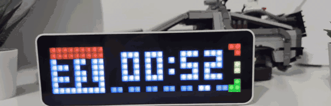
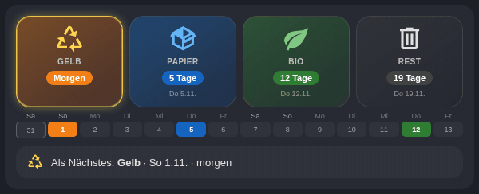
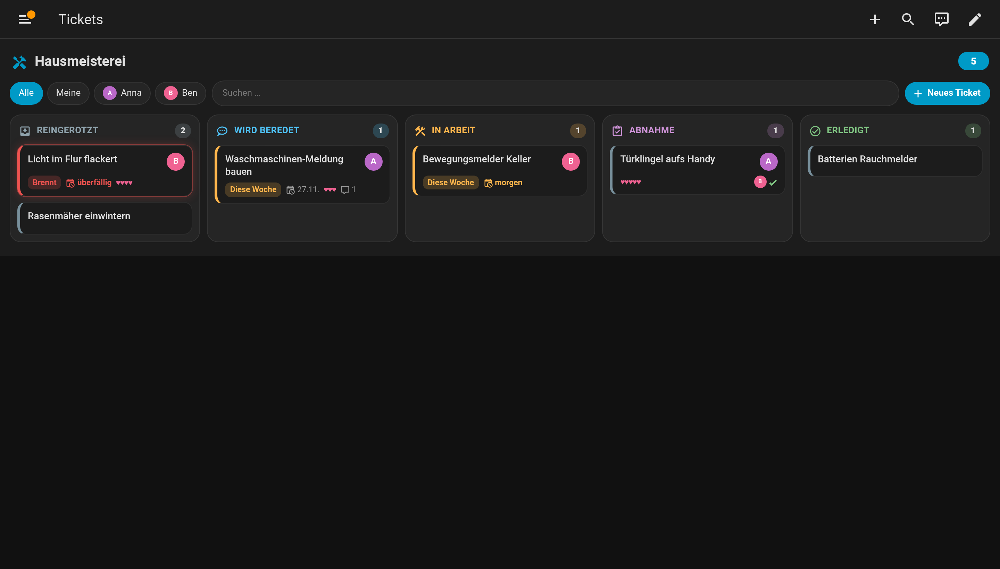

# Home-Assistant-Blueprints aus Kily's World

Fertige Automationen für [Home Assistant](https://www.home-assistant.io/) – mit einem Klick importieren, Geräte auswählen, fertig. Kein YAML, kein Kopieren von Code.

🇬🇧 *English: guides and overview [below](#english).*

Sortiert nach den Seiten unseres Dashboards. Wie es bei uns aussieht und was noch kommt, steht im Blog: **[Kily's World – Unser Dashboard](https://kilysworld.com/dashboard/)**.

## Übersicht

Die Startseite: Strompreis, Müll, Hausgeräte – und alles, was auf den AWTRIX-Pixeluhren landet.

 

| Blueprint | Was er macht | Importieren |
|---|---|---|
| **AWTRIX – aktueller Strompreis** | Zeigt den Strompreis auf der Pixeluhr, grün/gelb/rot je nach Preis |  |
| **AWTRIX – Akku-Ampel in der Ecke** | Färbt eine Ecke der Uhr nach dem Akkustand, von Rot über Gelb nach Grün |  |
| **AWTRIX – Müll-Ampel in der Ecke** | Eine Ecke leuchtet in der Farbe der Tonne, die morgen abgeholt wird – aus jedem Abfallkalender |  |
| **Waschmaschine, Trockner & Co. – fertig melden** | Nachricht aufs Handy, wenn das Gerät fertig ist – erkannt über eine Steckdose mit Strommessung, mit Erinnerung, wenn die Wäsche noch drin ist |  |
| **Müll – Erinnerung am Vorabend** | „🟦 Papier, 🟨 Gelber Sack – bitte heute Abend rausstellen.“ aus jedem Abfallkalender |  |
| **Müll – Plan für die Kachel-Karte** | Sammelt die Termine je Tonne für die Müll-Kachel-Karte |  |
| **Monatsrückblick – dein Haus-Wrapped** | Am 1. eine Nachricht mit den Zahlen des letzten Monats: PV, Netz, Verbrauch, Temperaturen – mit Vergleich zum Vormonat, Highlight und auf Wunsch „reicht für X km im E-Auto“. Aus der Langzeitstatistik, ohne Hilfszähler. Dazu die [Haus-Wrapped-Karte](docs/monatsrueckblick.md#profi-die-haus-wrapped-karte) als Profi-Variante |  |

**Energie:** die [Prognose mit Preisband](docs/energie_prognose.md) – Strompreis als farbiges Band mit den günstigsten Stunden, Solar-Prognose und Tageskurve.

**Unsere Optik zum Nachbauen:** das [Glas-Kit](docs/glas_karten.md) – button-card-Vorlagen für Glas-Kacheln, Licht in Lampenfarbe, Fenster mit Puls und eine Statusleiste.

**Dazu passend:** die [Müll-Kachel-Karte fürs Dashboard](docs/muell.md#2-kachel-karte) – nur eingebaute Karten, zum Einfügen per Kopieren – und die [Profi-Variante](docs/muell.md#profi-variante-unsere-karte-mit-button-card) mit button-card, so wie bei uns.

## Kamera

| Blueprint | Was er macht | Importieren |
|---|---|---|
| **Klingel – Nachricht mit Kamerabild** | Klingelt es, kommt eine Nachricht mit Bild von der Tür aufs Handy – auch mit einem 10-€-Vibrationssensor am alten Gong |  |
| **Klingel aufs TV – Bild-im-Bild** | Klingelt es, während der Fernseher läuft, pausiert der Film und die Haustür erscheint als Bild-im-Bild, mit „Weiterschauen“ und „Bild schließen“ (App QuickBars auf Android TV) |  |

## Autos

| Blueprint | Was er macht | Importieren |
|---|---|---|
| **Willkommenslicht – in der Farbe der Person** | Kommt jemand heim, leuchtet das Licht im Eingang in seiner Farbe (bei uns die Farbe des Autos), kommen zwei, wechseln die Farben; danach wieder wie vorher |  |
| **Smartladen mit Abfahrtszeit (evcc)** | Abfahrt und Ladeziel in Home Assistant einstellen, evcc lädt in den günstigsten Viertelstunden – zur Abfahrt wird der Plan wieder gelöscht, später angesteckt wird nachgezogen |  |

[Was noch kommt](https://kilysworld.com/dashboard/#cars)

## Automatisierung

| Blueprint | Was er macht | Importieren |
|---|---|---|
| **Sonnenschutz je Fassade** | Rollos runter, wenn die Sonne wirklich auf die Seite scheint und es warm ist – hoch erst, wenn sie weg ist. Kein Jo-Jo bei Wolken |  |
| **Türen abschließen, wenn niemand zu Hause ist** | Sind alle weg, schließen die smarten Schlösser nach 30 Minuten ab – eine offen stehende Tür wird nicht verriegelt, sondern gemeldet. Mit Schalter für Gäste |  |
| **Gute Nacht per Sprachbefehl** | „Hey Google, gute Nacht“ schaltet einen Helfer, Home Assistant macht den Rest: Lichter aus, Rollos zu, abschließen (nur bei geschlossener Tür), Flurlicht noch ein paar Minuten an. Offene Fenster sagt der Lautsprecher an. Optional Frost-, Hitze- und Gästemodus |  |
| **Licht- und Radiowecker** | Sonnenaufgang am Bett (rot → orange → warmweiß) vor der Weckzeit, dann das Radio – nur an Arbeitstagen, nicht im Urlaub, Abbruch durch Ausschalten, danach gedimmt aus |  |
| **AWTRIX – Warnung, solange Tür oder Tor offen ist** | Eine Ecke blinkt, solange Garagentor oder Hoftor offen sind – auf Wunsch mit Meldung, die bis zum Schließen stehen bleibt |  |
| **Zigbee-Wächter** | Hängt der Zigbee-Koordinator, startet Home Assistant Chip und Zigbee2MQTT selbst neu und sagt Bescheid – fragt dafür alle 5 Minuten aktiv nach, statt auf Stille zu warten |  |
| **Stumme Geräte melden** | Meldet Zigbee-Geräte, die sich nicht mehr melden – meist ist die Batterie leer, Home Assistant zeigt aber weiter den letzten Wert. Nach dem Tausch „Wieder da“, auf Wunsch Wochenübersicht |  |

➡️ **Schritt-für-Schritt-Anleitungen:** [AWTRIX-Blueprints](docs/awtrix.md) · [Klingel](docs/klingel.md) · [Klingel aufs TV](docs/klingel_tv.md) · [Sonnenschutz](docs/sonnenschutz.md) · [Waschmaschine & Co.](docs/geraet_fertig.md) · [Müll](docs/muell.md) · [Türen abschließen](docs/tueren_abschliessen.md) · [Zigbee-Wächter](docs/zigbee_waechter.md) · [Stumme Geräte](docs/stumme_geraete.md) · [Gute Nacht](docs/gute_nacht.md) · [Wecker](docs/wecker.md) · [Smartladen](docs/smartladen.md) · [Monatsrückblick](docs/monatsrueckblick.md)

**Was soll als Nächstes kommen?** Wünsche gern unter [Ideen](https://github.com/johnkily/ha-blueprints/discussions/categories/ideas) oder in den Kommentaren im Blog.

## Hausmeisterei

Unser Ticketsystem für alles, was im Haus zu tun ist – zum Nachbauen in drei Stufen, ganz ohne Skripte: einfach mit To-do-Listen, als Profi-Board und mit Erinnerungen. [Anleitung](docs/ticket_board.md)

| Baustein | Was er macht | Importieren / Anleitung |
|---|---|---|
| **Ticket-Board einfach – Abhaken schiebt weiter** | Board aus zwei oder drei To-do-Listen mit eingebauten Karten: Abhaken schiebt einen Eintrag in die nächste Spalte, auf Wunsch mit Nachricht. Nichts zu installieren |  |
| **Ticket-Board** | Kanban-Board für Wünsche und Aufgaben: Spalten, Priorität, Zuständige mit Foto, Fälligkeit, Herzchen, Verlauf und Abnahme. Daten in einer normalen To-do-Liste von Home Assistant. Installation über den Marketplace |  [So geht's](docs/ticket_board.md) |
| **Ticket-Board – Erinnerungen** | Ergänzung zur Karte: jeden Morgen eine Nachricht mit Fälligem, Überfälligem, wartenden Abnahmen und liegengebliebenen „Brennt“-Tickets, jeder Zuständige bekommt seine eigenen. Neue „Brennt“-Tickets sofort |  |

## So funktioniert der Import

1. Auf den blauen Knopf **„Importieren“** klicken. Beim ersten Mal fragt die Seite nach der Adresse deines Home Assistant – eintragen, merken lassen.
2. In Home Assistant öffnet sich der Import-Dialog → **„Blueprint importieren“**.
3. Unter *Einstellungen → Automationen & Szenen → Blueprints* den Blueprint antippen, Geräte auswählen, **Speichern**.

**Aktualisieren:** Kommt eine neue Version, unter *Blueprints* auf die drei Punkte → **„Blueprint erneut importieren“**. Deine Einstellungen bleiben erhalten.

## Unterstützen

Alles hier ist kostenlos und bleibt es. Wenn dir ein Blueprint Zeit oder Strom spart, freue ich mich über einen Kaffee:

Oder einfach den Blog weiterempfehlen – und hier oben rechts einen ⭐ dalassen. Das hilft anderen, die Blueprints zu finden.

## Im Home-Assistant-Forum

- [AWTRIX 3 – current electricity price in traffic-light colours](https://community.home-assistant.io/t/awtrix-3-current-electricity-price-in-traffic-light-colours-works-with-any-price-sensor-tibber-nordpool-epex/1030093)
- [AWTRIX 3 – waste bin indicator from any waste calendar](https://community.home-assistant.io/t/awtrix-3-waste-bin-indicator-corner-lights-up-in-the-colour-of-tomorrows-bin-from-any-waste-calendar-ics/1030267)
- [Waste collection dashboard from any calendar – next pickup per bin, no HACS](https://community.home-assistant.io/t/waste-collection-dashboard-from-any-calendar-ics-next-pickup-per-bin-two-week-strip-no-hacs-needed/1030765)

## Probleme oder Ideen?

Bitte ein [Issue](https://github.com/johnkily/ha-blueprints/issues) anlegen – mit Home-Assistant-Version und dem, was du erwartet hättest.

---

*Mit \* gekennzeichnete Links sind Affiliate-Links. Kaufst du darüber, bekomme ich eine kleine Provision, für dich ändert sich am Preis nichts. Als Amazon-Partner verdiene ich an qualifizierten Verkäufen.*

## English

Ready-made Home Assistant automations: click **Import**, pick your devices, done. Like them? [Buy me a coffee on Ko-fi](https://ko-fi.com/johnkily).

**Step-by-step guides in English:** [AWTRIX blueprints](docs/en/awtrix.md) · [Doorbell](docs/en/klingel.md) · [Doorbell on the TV](docs/en/klingel_tv.md) · [Sun protection](docs/en/sonnenschutz.md) · [Washing machine & co.](docs/en/geraet_fertig.md) · [Waste bins](docs/en/muell.md) (with an English tile card) · [Lock the doors](docs/en/tueren_abschliessen.md) · [Zigbee watchdog](docs/en/zigbee_waechter.md) · [Silent devices](docs/en/stumme_geraete.md) · [Welcome light](docs/en/willkommenslicht.md) · [Good night](docs/en/gute_nacht.md) · [Alarm clock](docs/en/wecker.md) · [Smart charging](docs/en/smartladen.md) · [Monthly review](docs/en/monatsrueckblick.md) · [Glass kit for cards](docs/en/glas_karten.md) · [Forecast with price band](docs/en/energie_prognose.md) · [Ticket board card](docs/en/ticket_board.md)

| Blueprint | What it does | Import |
|---|---|---|
| AWTRIX – current electricity price | Current electricity price on the pixel clock, green/yellow/red |  |
| AWTRIX – battery traffic light in the corner *(German labels)* | A corner of the clock shows the battery level, red → yellow → green |  |
| AWTRIX – waste bin indicator in the corner | A corner lights up in the colour of tomorrow's bin, from any waste calendar |  |
| AWTRIX – warning while a door or gate is open *(German labels)* | A corner blinks while the garage door or gate is open, optional notification on the clock |  |
| Doorbell – notification with camera picture *(German labels)* | Doorbell rings → notification with a camera picture, works with a 10 € vibration sensor on an old chime |  |
| Doorbell on the TV – picture-in-picture *(German labels)* | Doorbell rings while the TV is on → playback pauses, the door camera shows as picture-in-picture with "continue" / "close" buttons (QuickBars app on Android TV) |  |
| Sun protection per facade *(German labels)* | Blinds go down when the sun really hits that side of the house – no up and down with every cloud |  |
| Washing machine, dryer & co. – done notification *(German labels)* | Notification when the appliance is done, detected via a power-metering plug |  |
| Waste – plan for the tile card | Data for the waste bin tile card: next pickup per bin and a two-week strip |  |
| Waste – reminder the evening before | Notification the evening before a pickup, several bins in one message |  |
| Lock doors when nobody is home | Locks the smart locks once everybody has left – doors that are open are reported, not bolted |  |
| Zigbee watchdog – restart a stuck coordinator *(German labels)* | If the Zigbee coordinator gets stuck, restarts the chip and Zigbee2MQTT and notifies you – asks a device every 5 minutes instead of waiting for silence |  |
| Report silent devices (empty battery) | Notifies when Zigbee devices stop reporting – usually an empty battery, while Home Assistant keeps showing the last value. “Back again” after the swap, optional weekly overview |  |
| Welcome light in each person's colour *(German labels)* | Someone comes home → the entrance light glows in their colour (ours: the car colour), two people → alternating colours, then back to before |  |
| Good night by voice command *(German labels, English announcements)* | “Hey Google, good night” switches a helper, Home Assistant does the rest: lights off, blinds down, locks (only if the door is closed), path light for a few minutes. Open windows are announced |  |
| Light and radio alarm clock *(German labels)* | Sunrise at the bed (red → orange → warm white) before the alarm, then the radio – workdays only, not on holiday, stops when you switch the light off, dims before turning off |  |
| Smart charging with departure time (evcc) *(German labels)* | Set departure and target in Home Assistant, evcc charges in the cheapest quarter hours – the plan is deleted at departure |  |
| Monthly review – your home's “Wrapped” *(German labels, English messages)* | On the 1st a message with last month's numbers: PV, grid, consumption, temperatures – compared to the month before, with a highlight and optional “enough for X km in an EV”. From long-term statistics, no helper counters |  |
| Simple ticket board – ticking moves items on *(German labels)* | Two or three to-do lists as columns with built-in cards: ticking an item moves it to the next list, optional notification. Nothing to install |  |
| Ticket board reminders *(German labels, English messages)* | Add-on for the ticket board card: a morning message with due, overdue, waiting reviews and urgent tickets nobody touches, every assignee gets their own. New urgent tickets right away |  |

Blueprints marked *(German labels)* show German field names in Home Assistant – the English guides explain every field. More English versions will follow; tell us in an [issue](https://github.com/johnkily/ha-blueprints/issues) which one you need first. Questions in English are welcome there or under [Ideas](https://github.com/johnkily/ha-blueprints/discussions/categories/ideas).

Lizenz / License: [MIT](LICENSE) · [Impressum](https://kilysworld.com/impressum/) · [Datenschutz](https://kilysworld.com/datenschutz/)
