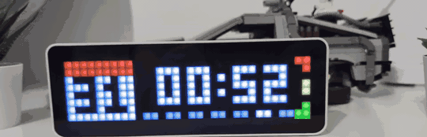

# AWTRIX blueprints – step by step

*[Deutsche Fassung](../awtrix.md)*

Four blueprints for the AWTRIX pixel clock:

- **Electricity price** – its own app on the clock shows the current price, e.g. `24.1` in green, `29.0` in yellow, `33.0` in red.
- **Battery traffic light** – one corner lights up depending on the state of charge: empty red, half yellow, full green, smoothly in between.
- **Waste bin indicator** – from the evening before, one corner lights up in the colour of the bin that is collected; on collection day it blinks in the morning.
- **Door/gate open** – a corner blinks as long as the garage door, gate or a window is open; optionally with a notification on the clock that stays until everything is closed.

Each can be used on its own, and all of them work with several clocks at once.

> **Note:** the input labels inside the blueprints are German. This guide gives the German label as it appears in Home Assistant, followed by its meaning.

## What you need

| | |
|---|---|
| **Clock** | Ulanzi TC001 Smart Pixel Clock* ([Amazon.de](https://link.amazon/B06xvJcpa)) with the free **AWTRIX 3** firmware |
| **MQTT** | The **Mosquitto broker** add-on and the **MQTT** integration in Home Assistant |
| **Electricity price** | A sensor with the current price – e.g. from the Tibber integration, Nordpool or EPEX Spot. Both €/kWh and ct/kWh are recognised. |
| **Battery traffic light** | A sensor in percent, e.g. the state of charge of your home battery or EV |
| **Waste bin indicator** | Your waste collection calendar as a calendar in Home Assistant (see [below](#add-your-waste-calendar)) |

## 1. Prepare the clock (once)

1. **Flash AWTRIX 3:** connect the clock to your computer via USB-C, open the [AWTRIX 3 flasher](https://blueforcer.github.io/awtrix3/#/flasher) in Chrome or Edge and follow the instructions. **Tick “Erase” the first time**, otherwise the original firmware gets in the way. Takes about two minutes.
2. **Wi-Fi:** the clock then opens its own Wi-Fi “awtrix_…”. Connect to it and enter your home Wi-Fi. The clock then shows its IP address.
3. **MQTT in Home Assistant:** *Settings → Add-ons → Add-on store* → install and start **Mosquitto broker**. Home Assistant then offers the **MQTT** integration – add it.
4. **A user for the clock:** *Settings → People → Users* → create a new user, e.g. `awtrix` with a password. (Mosquitto uses the Home Assistant users.)
5. **Connect the clock to MQTT:** open the clock's IP in your browser → **MQTT**:
   - Broker: IP address of your Home Assistant
   - Port: `1883`
   - User and password from step 4
   - Note the **Prefix** (e.g. `awtrix_a1b2c3`) – this is the *MQTT name of the clock* the blueprints ask for.

   Save, the clock restarts. It now shows up in Home Assistant as a device under *MQTT*.

## 2. Import the blueprint

| Electricity price | Battery traffic light | Waste bin indicator |
|---|---|---|
|  |  |  |

Tap the button → **“Import blueprint”**.

Questions and feedback on the electricity price blueprint: [topic in the Home Assistant forum](https://community.home-assistant.io/t/awtrix-3-current-electricity-price-in-traffic-light-colours-works-with-any-price-sensor-tibber-nordpool-epex/1030093).

## 3. Create the automation

*Settings → Automations & scenes → Blueprints* → tap the blueprint.

### Electricity price (*AWTRIX – aktueller Strompreis*)

| Field (German label) | What to enter |
|---|---|
| Strompreis-Sensor – *price sensor* | your price sensor, e.g. “Electricity price” from Tibber |
| MQTT-Name der Uhr(en) – *MQTT name of the clock(s)* | the prefix from step 1.5 – several clocks separated by commas: `awtrix_a1b2c3, awtrix_d4e5f6` |
| Grün bis (ct/kWh) / Rot ab (ct/kWh) – *green up to / red from* | your price limits in ct/kWh (default: green up to 25, red from 33) |
| Nachkommastellen – *decimal places* | 1 fits the clock well; with an icon, 2 decimals get tight |
| Icon bei günstigem Preis / Icon bei mittlerem und hohem Preis (optional) – *icons* | an icon stored on the clock (see below); leaving it empty is fine |
| Anzeigedauer (Sekunden) – *display time* | seconds per cycle (default 10) |

The price is sent on every change and additionally every 15 minutes. If the sensor stays silent for 30 minutes, the app disappears instead of showing an outdated price.

### Battery traffic light (*AWTRIX – Akku-Ampel in der Ecke*)

| Field (German label) | What to enter |
|---|---|
| Ladestand-Sensor – *state of charge sensor* | e.g. the battery state of charge of your inverter |
| MQTT-Name der Uhr(en) | as above |
| Ecke – *corner* | one of the three corners on the right (default: middle) |

**Save** – done. The clock reacts to the next new value, at the latest after a restart of Home Assistant.

### Waste bin indicator (*AWTRIX – Müll-Ampel in der Ecke*)

| Field (German label) | What to enter |
|---|---|
| Abfallkalender – *waste calendar* | your waste collection calendar (see next section) |
| MQTT-Name der Uhr(en) | as above |
| Ecke – *corner* | default: top right. Don't use the same corner as the battery traffic light. |
| Anzeigen ab (Vortag) / Anzeigen bis (Abholtag) – *show from (day before) / until (collection day)* | default: from 15:00 the day before until 10:00 on collection day |
| Am Abholtag blinken – *blink on collection day* | in the morning, as a reminder that the bin has to go out |
| Tonnen – *bins* (expand) | Which words in the calendar event belong to which bin, and the colours. The defaults are German (Rest/Grau = residual, Papier/Blau = paper, Gelb/Wertstoff = recycling, Bio/Braun = organic). **Replace them with the words your calendar uses**, e.g. “Paper”, “Recycling”, “Garden”. Case doesn't matter; several words separated by commas. |

The indicator checks every 10 minutes. If two bins are collected on the same day, it shows the first one in the list.

Questions and feedback are welcome in the [Home Assistant forum](https://community.home-assistant.io/t/awtrix-3-waste-bin-indicator-corner-lights-up-in-the-colour-of-tomorrows-bin-from-any-waste-calendar-ics/1030267).

### Door/gate open (*AWTRIX – Warnung, solange Tür oder Tor offen ist*)

| Field (German label) | What to enter |
|---|---|
| Türen, Tore, Fenster – *doors, gates, windows* | the sensors, e.g. garage door and gate (binary sensors or covers) |
| MQTT-Name der Uhr(en) | as above |
| Erst warnen nach – *warn after* | e.g. 5 minutes – then the clock doesn't warn when the garage door is open briefly while you drive out. 0 = immediately. |
| Ecke, Farbe, Blinken (Millisekunden) – *corner, colour, blinking* | default: top right, red, 500 ms. 0 ms = steady light. |
| Zusätzlich Meldung anzeigen – *also show a notification* | the notification “OFFEN: Garagentor” stays in front until everything is closed again (or someone presses the middle button). *Text der Meldung* changes the text; *Ausgeschaltete Uhr für die Meldung einschalten* also wakes a clock that is switched off. |

If several are open, the notification names all of them; the corner stays red until the last one is closed. The clock keeps cycling through its apps as usual.

## Add your waste calendar

Most cities or waste companies offer the collection calendar as an **ICS file** or **calendar subscription** (search for “waste collection ICS” + your city).

1. Copy the link to the ICS file (it usually ends in `.ics`).
2. In Home Assistant: *Settings → Devices & services → Add integration* → **Remote Calendar**.
3. Give it a name (e.g. “Waste”) and paste the link. Done – the calendar is then called `calendar.waste`.

Alternatively, the HACS integration [Waste Collection Schedule](https://github.com/mampfes/hacs_waste_collection_schedule) provides a calendar directly for a great many cities.

## Load icons onto the clock

AWTRIX only shows icons that are stored on the clock:

1. Search for an icon in the [LaMetric icon gallery](https://developer.lametric.com/icons) and note its number (e.g. `53295`).
2. Clock web interface → **Icons** → enter the number → download.
3. Enter the number in the icon field of the blueprint.

## Not working?

| Problem | Solution |
|---|---|
| Clock shows nothing | Is the **prefix** exactly right (upper/lower case)? Does the clock appear under *Settings → Devices → MQTT*? |
| Price is 100 times too high or too low | Which unit does your sensor show? Anything containing “ct” or “Cent” is treated as cents, everything else as euros. Please open an issue if your sensor uses a different unit. |
| Icon missing | The icon isn't stored on the clock – see above. |
| Waste indicator stays dark | Is there really an event tomorrow in the calendar? Does one of the keywords appear in the event title? Is it already past the *Anzeigen bis* time on collection day? |
| Automation doesn't run | Open the automation → **Traces** (top right) shows where it gets stuck. |

---

*Links marked with \* are affiliate links. If you buy through them, I get a small commission; the price stays the same for you. As an Amazon Associate I earn from qualifying purchases.*
