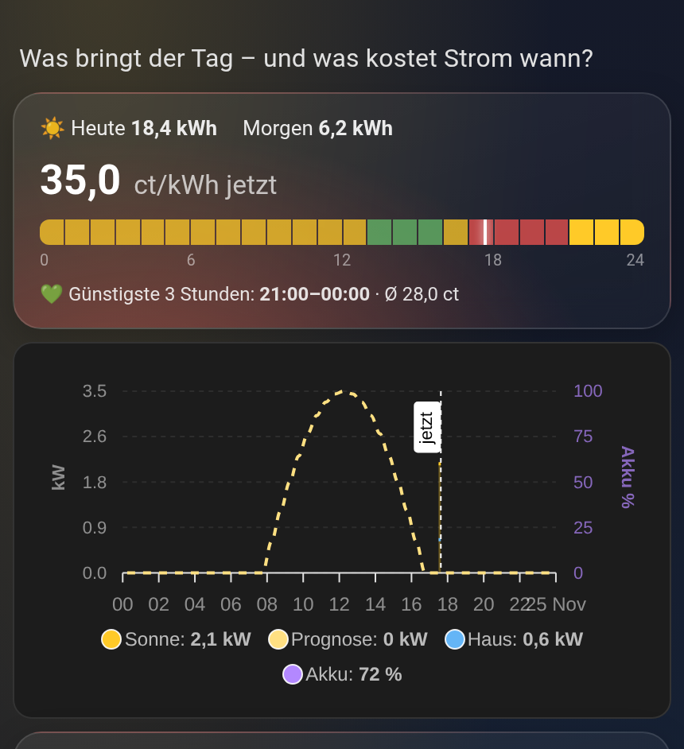

# Forecast with price band – what will the day bring, and when is power cheap?

*[Deutsche Fassung](../energie_prognose.md)*

*📰 From our house: [Kily's World in English](https://kilysworld.com/in-english/) – what our smart home looks like day to day*

A page from our energy carousel: the solar forecast for today and tomorrow, below it today's electricity price as a **coloured band** (green cheap, yellow medium, red expensive) with the **cheapest hours still to come**, and the **day curve**: solar production, house consumption, battery and the forecast as a dashed line.



## What you need

- **button-card** and **apexcharts-card** from the Marketplace (formerly HACS)
- **An electricity price sensor with a price list** in an attribute – e.g. Tibber, Nord Pool or EPEX Spot
- **Solar forecast** *(optional)*, e.g. Solcast
- **The glass kit** templates from the [glass kit guide](glas_karten.md), step 1 – it contains `glas_preisband`

## 1. Price band

```yaml
type: custom:button-card
template: glas_preisband
entity: sensor.electricity_price    # your price sensor with a list in an attribute
variables:
  prognose_heute: sensor.solcast_pv_forecast_forecast_today       # optional
  prognose_morgen: sensor.solcast_pv_forecast_forecast_tomorrow   # optional
  stunden: 3                        # length of the cheapest window in hours
```

The card looks for the list in `today`, `raw_today`, `prices`, `data` or `forecast`; each entry needs a start time (`start`, `startsAt`, `start_time` …) and a price (`total`, `value`, `price` …), in euro or cent. Other attribute name? Set `variables: attribut:`. Quarter-hour prices work too. Texts are German (“ct/kWh jetzt” = now, “Günstigste 3 Stunden” = cheapest 3 hours).

## 2. Day curve

The card is in [`energie_tageskurve.yaml`](https://github.com/johnkily/ha-blueprints/blob/main/karten/glas/energie_tageskurve.yaml) – paste it and replace the four entities (PV power in W, Solcast “forecast today”, house consumption in W, battery %). Keep colours like `"rgba(255,255,255,0.5)"` in quotes, or YAML splits them at the commas and the chart stays empty.

---

Like it? A ⭐ on [GitHub](https://github.com/johnkily/ha-blueprints) helps others find it.

**Did it work?** Then I'd be happy about a [coffee or tea on Ko-fi 🍵](https://ko-fi.com/johnkily).
