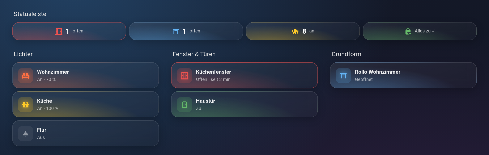

# Glass kit – how our cards get their look

*[Deutsche Fassung](../glas_karten.md)*

*📰 From our house: [Kily's World in English](https://kilysworld.com/in-english/) – what our smart home looks like day to day*

Our dashboard doesn't look like the default, and people asked how it's done. The secret is a handful of ingredients that are the same everywhere. Here they are as **button-card** templates.



## The four ingredients

| Ingredient | What it is |
|---|---|
| **Glass** | a light white gradient over a dark background, a thin bright border, 10 px blur, a soft shadow. Corners 18 px, 12 px inside |
| **Aurora** | a glow from the bottom in the card's meaning: amber = light on, red = open, green = closed, blue = blind open. For lamps it's the lamp's real colour |
| **Borders with meaning** | a coloured border only when it says something |
| **Pulse only for warnings** | an open window pulses gently, everything else stays calm |

Made for a **dark theme**. Glass looks best on a background with some colour (example below).

> The template and variable names are German (`glas_licht` = light, `glas_kontakt` = contact, `glas_leiste` = status bar, `farbe` = colour). Status texts are German too – change them in the YAML if you like.

## What you need

| | |
|---|---|
| **button-card** | from the Marketplace (formerly HACS) [](https://my.home-assistant.io/redirect/hacs_repository/?owner=custom-cards&repository=button-card&category=plugin) |
| **A dark theme** | e.g. the default theme in dark mode |

## 1. Add the templates

The templates are in [`glas_vorlagen.yaml`](https://github.com/johnkily/ha-blueprints/blob/main/karten/glas/glas_vorlagen.yaml). Edit dashboard → ⋮ → **Raw configuration editor** → paste the whole `button_card_templates:` block **at the very top**, before `views:`. Save.

## 2. Add cards

```yaml
type: custom:button-card
template: glas_licht        # light: aurora in the lamp colour, tap toggles
entity: light.living_room
name: Living room
icon: mdi:sofa
```

```yaml
type: custom:button-card
template: glas_kontakt      # window/door: green closed, red and pulsing open
entity: binary_sensor.kitchen_window
name: Kitchen window
```

```yaml
type: custom:button-card
template: glas_kachel       # basic tile, colour as "R,G,B"
entity: cover.living_room
variables:
  farbe: "100,181,246"
```

```yaml
type: grid                  # status bar: four segments that count themselves
columns: 4
square: false
cards:
  - { type: custom:button-card, template: glas_leiste, variables: { art: fenster } }
  - { type: custom:button-card, template: glas_leiste, variables: { art: rollos } }
  - { type: custom:button-card, template: glas_leiste, variables: { art: lichter } }
  - { type: custom:button-card, template: glas_leiste, variables: { art: schloesser } }
```

`art`: `fenster` = windows/doors, `rollos` = blinds, `lichter` = lights, `schloesser` = locks.

**One more template in the kit:** `glas_preisband` – the electricity price as a coloured band. How to use it is explained in [Forecast with price band](energie_prognose.md).

## 3. Background (optional)

```yaml
background: >-
  radial-gradient(ellipse at 15% 0%, rgba(66,165,245,.28), transparent 55%),
  radial-gradient(ellipse at 90% 100%, rgba(171,71,188,.25), transparent 60%),
  linear-gradient(160deg, #161b2b, #0f1320)
```

## Variables of the basic tile

| Variable | Meaning |
|---|---|
| `farbe` | colour as `"R,G,B"`, default amber `"255,202,40"` |
| `aktiv` | whether the aurora glows; default: on, open, unlocked, home, playing, heating |
| `rahmen` | `true` = coloured border when active |
| `puls` | `true` = pulses when active |

---

Like it? A ⭐ on [GitHub](https://github.com/johnkily/ha-blueprints) helps others find it.

**Did it work?** Then I'd be happy about a [coffee or tea on Ko-fi 🍵](https://ko-fi.com/johnkily).
