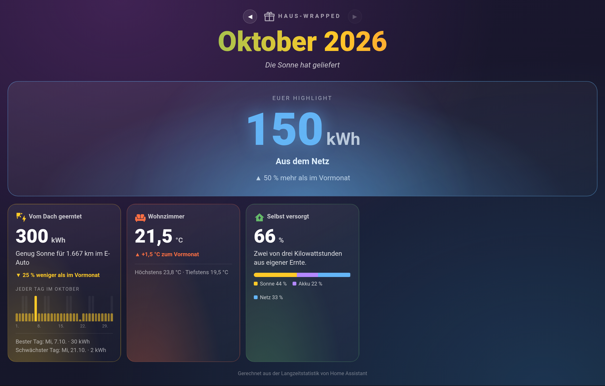

# Monthly review – your home's “Wrapped”

*[Deutsche Fassung](../monatsrueckblick.md)*

Spotify shows you what you listened to at the end of the year. This blueprint does that every month for your home. On the 1st you get a message with last month's numbers, compared to the month before, plus a highlight:

```
📊 Your home in November
☀️ PV yield: 312 kWh (↓ 68 %)
⚡ Grid import: 140 kWh (↑ 35 %)
🌡️ Living room: Ø 21.3 °C, max 23.8 °C (+0.8 °C)
🚗 Enough for 1,733 km in an EV
🏆 Biggest change: PV yield ↓ 68 %
```

There's also a [pro version](#pro-the-home-wrapped-card): a card that shows the whole month as a colourful page.

The numbers come from Home Assistant's **long-term statistics** – no helper counters, no scripts. Any sensor that shows months of history in the energy dashboard or a history graph works.

> The blueprint has German field names – this guide translates them. Set “Sprache der Nachricht” to **English** for English messages.

## What you need

| | |
|---|---|
| **Home Assistant 2026.10 or newer** | for the action `recorder.get_statistics` |
| **Sensors with statistics** | e.g. PV yield, grid import, export, heat pump, gas, water, temperatures |
| **Phone** *(optional)* | the Home Assistant app for the message |

## 1. Import the blueprint

[](https://my.home-assistant.io/redirect/blueprint_import/?blueprint_url=https%3A%2F%2Fgithub.com%2Fjohnkily%2Fha-blueprints%2Fblob%2Fmain%2Fblueprints%2Fautomation%2Fhaus%2Fmonatsrueckblick.yaml)

## 2. Create the automation

*Settings → Automations & scenes → Blueprints* → **Monatsrückblick – dein Haus-Wrapped**

| Field | What to enter |
|---|---|
| Sensoren für den Rückblick (*sensors*) | five to eight sensors, in the order of the message |
| Uhrzeit am 1. des Monats (*time on the 1st*) | default 10:00 |
| Vergleich zum Vormonat (*compare to last month*) | arrow with percent for meters, difference for measurements |
| Umrechnen in E-Auto-Kilometer (*convert to EV km*) | e.g. PV yield, plus your car's consumption (default 18 kWh/100 km) |
| Handys / Auch in Home Assistant / Eigenes Skript | where the message goes (phones, HA notification, own script) |
| Dashboard-Pfad (*dashboard path*) | tapping the message opens e.g. your energy dashboard |

**To try it** without waiting for the 1st: open the automation → ⋮ → **Run**. You get last month's review right away.

## How it calculates

- **Meters** (kWh, m³, €, anything that only grows) → monthly total, compared in percent.
- **Measurements** (°C, %, W) → average and maximum, compared as a difference.
- **Highlight** is the meter with the biggest change compared to the month before.
- Sensors without values last month (e.g. brand new) are simply left out.

## Pro: the Home Wrapped card

The message is nice, but our own “Wrapped” is a whole dashboard page. You can get it as a card:



- big month name with a colour gradient and the **highlight of the month**
- one tile per sensor with comparison to last month, **best and weakest day** or max and min
- optional **daily bars** and a **source bar** (sun, battery, grid)
- browse the months with ◀ ▶
- the card calculates everything from long-term statistics itself – no script, no helper sensor, not even the blueprint above
- German and English, following your Home Assistant language

### Install

**Via the Marketplace (formerly HACS), recommended** – updates with one click:

[](https://my.home-assistant.io/redirect/hacs_repository/?owner=johnkily&repository=haus-wrapped-card&category=plugin)

**Or by hand:**

1. Download [`haus-wrapped-card.js`](https://github.com/johnkily/haus-wrapped-card/blob/main/haus-wrapped-card.js) and copy it to `/config/www/`.
2. *Settings → Dashboards → ⋮ → Resources → Add resource*: `/local/haus-wrapped-card.js?v=1`, type **JavaScript module**.
3. Reload the browser or app.

### Add it

Best on its own dashboard page with view type **Panel**. *Add card → Manual*:

```yaml
type: custom:haus-wrapped-card
motto: The sun delivered
tiles:
  - entity: sensor.pv_yield
    title: Harvested on the roof
    icon: mdi:solar-power
    color: "#ffca28"
    text: Enough sun for {km} km in an EV
    chart: true
  - entity: sensor.grid_import
    title: From the grid
  - title: Self-sufficient
    parts:
      - { entity: sensor.pv_self_consumption, name: Sun, color: "#ffca28", own: true }
      - { entity: sensor.battery_discharge, name: Battery, color: "#b388ff", own: true }
      - { entity: sensor.grid_import, name: Grid, color: "#64b5f6" }
```

| Option | Meaning |
|---|---|
| `tiles` (or `kacheln`) | the tiles, in this order |
| `entity` | a sensor with long-term statistics |
| `title`, `icon`, `color` | heading, icon, colour of the tile |
| `text` | a sentence below the number, placeholders `{value}`, `{unit}`, `{km}` (value ÷ `ev_consumption` × 100, default 18 kWh/100 km) and `{last_month}` |
| `chart: true` | daily bars for the month |
| `parts` | instead of `entity`: several meters as a source bar; the big number is the sum of the parts with `own: true` |
| `highlight: true` | use this tile as the highlight; otherwise the one with the biggest change |
| `art: summe` / `art: mittel` | only if the card mixes up meter and measurement |

**With the blueprint:** set the page with the card as “Dashboard-Pfad” in the blueprint. On the 1st the message arrives, and tapping it opens the whole review.

## Not working?

| Problem | Solution |
|---|---|
| A sensor is missing | Does it have long-term statistics (`state_class` set)? Brand new sensors don't have a full month yet. |
| Values look too high | Meters that reset need `state_class: total_increasing`. |
| Import error | Home Assistant older than 2026.10 – `recorder.get_statistics` doesn't exist there yet. |

---

Like it? A ⭐ on [GitHub](https://github.com/johnkily/ha-blueprints) helps others find it.
