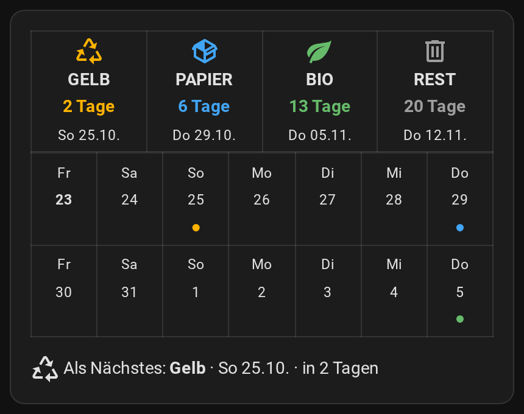
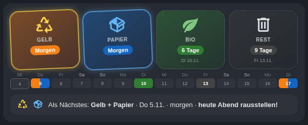
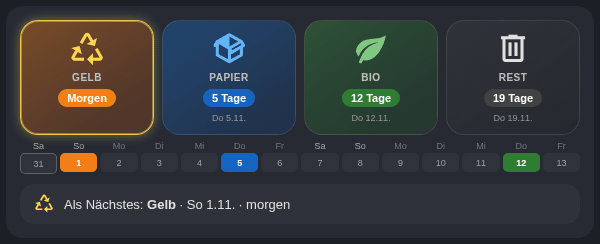

# Waste bins: tile card, reminder and AWTRIX indicator

*[Deutsche Fassung](../muell.md)*

Everything from one waste collection calendar – no HACS, no `configuration.yaml`:

- **Tile card** for your dashboard: four bins with “in 6 days”, below them two weeks as a mini calendar with coloured dots, and “Next up”.
- **Reminder the evening before** (blueprint): “🟦 Paper, 🟨 Recycling – please put out tonight.”
- **Waste bin indicator** on the AWTRIX pixel clock (blueprint): see the [AWTRIX guide](awtrix.md#waste-bin-indicator).



> **English versions** of the blueprints (English labels, keywords and notifications) are linked below. The original German blueprints stay available – see the [German guide](../muell.md).

## 1. Add your waste calendar

Most cities or waste companies offer the collection calendar as an **ICS file** or **calendar subscription** (search for “waste collection ICS” + your city).

1. Copy the link to the ICS file (it usually ends in `.ics`).
2. In Home Assistant: *Settings → Devices & services → Add integration* → **Remote Calendar**.
3. Enter the name “Waste” and paste the link. The calendar is then called `calendar.waste`.

Alternatively, the HACS integration [Waste Collection Schedule](https://github.com/mampfes/hacs_waste_collection_schedule) provides a calendar directly for a great many cities.

## 2. Bins and keywords

The blueprints recognise a bin by **words in the event title**. The defaults of the English versions:

| Bin | Colour | default keywords (case doesn't matter) |
|---|---|---|
| Paper | blue | Paper, Cardboard |
| Recycling | yellow | Recycling, Plastic, Packaging, Cans |
| Organic | green | Garden, Food, Organic, Compost |
| General waste | grey | General, Rubbish, Residual, Refuse, Landfill |

**Adjust them to the words your calendar uses.** You'll find them in each blueprint under **Bins** (expand): *General waste – keywords*, *Paper – keywords*, *Recycling – keywords*, *Organic – keywords*. Several words separated by commas; one matching word is enough. Events that match no bin (e.g. bulky waste) are ignored by the card.

**Exclude with `!`:** a keyword with an exclamation mark in front filters events out. If your collector lists both “General waste” and “General waste container”, `General, !Container` matches only the bin. Works in the plan, reminder and AWTRIX waste blueprints. Requested in [issue #1](https://github.com/johnkily/ha-blueprints/issues/1).

## 3. Tile card

The card needs the dates **per bin**. A blueprint collects them in a text helper.

**a) Create the helper:** *Settings → Devices & services → Helpers → Create helper → **Text***. Name **Waste plan**, maximum length **255**. (Home Assistant then calls it `input_text.waste_plan`.)

**b) Blueprint “Waste – plan for the tile card”:**

[](https://my.home-assistant.io/redirect/blueprint_import/?blueprint_url=https%3A%2F%2Fgithub.com%2Fjohnkily%2Fha-blueprints%2Fblob%2Fmain%2Fblueprints%2Fautomation%2Fen%2Fwaste%2Fwaste_plan.yaml)

Open it under *Settings → Automations & scenes → Blueprints*, choose the **Waste calendar** and your *Waste plan* helper under **Text helper “Waste plan”**, adjust the keywords under **Bins**, save. It updates every three hours, after midnight and when Home Assistant starts.

**c) Add the card:** dashboard → **Edit** → **Add card** → at the very bottom **Manual** → paste everything → **Save**.

```yaml
# Waste bin tile card for Home Assistant – core Markdown card only, no HACS.
# Needs the text helper "Waste plan" (input_text.waste_plan), filled by the
# blueprint "Waste – plan for the tile card".
# Add it: edit dashboard → Add card → at the very bottom "Manual" →
# paste everything → Save. If your helper has a different name, change line 14.
# Guide: https://github.com/johnkily/ha-blueprints/blob/main/docs/en/muell.md
type: markdown
content: |
  
  
  
  
  
  
  
  
    
    
  
  
  
  No pickups yet – is the blueprint “Waste – plan for the tile card” running?
  
  <table width="100%"><tr>
  
  <td align="center" width="25%"><font color="{{ c.colour }}"><ha-icon icon="{{ c.icon }}"></ha-icon></font><br><b>{{ c.name | upper }}</b><br><font color="{{ c.colour }}"><b>TodayTomorrow{{ t.days }} days</b></font><br><small>{{ wd[t.day.weekday()] }} {{ t.day.day }} {{ mon[t.day.month - 1] }}</small></td>
  
  </tr></table>

  <table width="100%">
  <tr>
  
  <td align="center" width="14%"><small>{{ wd[d.weekday()] }}<br><b>{{ d.day }}</b>{{ d.day }}</small><br><font color="{{ bins[s[10:]].colour }}">●</font>&nbsp;</td>
  </tr>
  
  </table>

  
  {{ nx.icons }} Next up: **{{ nx.names | join(' + ') }}** · {{ wd[n.day.weekday()] }} {{ n.day.day }} {{ mon[n.day.month - 1] }} · todaytomorrowin {{ n.days }} days
  

  <ha-alert alert-type="warning">Put it out tonight!</ha-alert>
  
  
```

The bins are sorted by their next pickup. In the afternoon before a pickup, “Put it out tonight!” appears. If two bins are collected on the same day, “Next up” names both and the strip shows both dots (in the button-card version the day box is split). Names, icons and colours are at the top of the code (`bins`).





**More cards:** a simpler card without a helper (reads only the next event from the calendar) and our advanced variant with coloured tiles (needs *button-card* from HACS, uses the same helper) are in the [German guide](../muell.md#ohne-helfer-die-schlichte-variante) – their labels are German, but the code works the same way; for the advanced card, change `input_text.mull_plan` to `input_text.waste_plan`.

## 4. Reminder the evening before

[](https://my.home-assistant.io/redirect/blueprint_import/?blueprint_url=https%3A%2F%2Fgithub.com%2Fjohnkily%2Fha-blueprints%2Fblob%2Fmain%2Fblueprints%2Fautomation%2Fen%2Fwaste%2Fwaste_reminder.yaml)

*Settings → Automations & scenes → Blueprints* → **Waste – reminder the evening before**.

| Field | What to enter |
|---|---|
| Waste calendar | `calendar.waste` |
| Time of the reminder | default 19:00 |
| Phones | who should be reminded |
| Only phones that are at home | default off – whoever is away still knows |
| Bins (expand) | the keywords per bin (see step 2) |

If several bins are due, they all come in one notification. Events that match no bin (e.g. bulky waste) appear with their own name.

The notification: title *“Waste collection tomorrow”*, text e.g. *“🟦 Paper, 🟨 Recycling – please put out tonight.”*

Questions and feedback are welcome in the [Home Assistant forum](https://community.home-assistant.io/t/waste-collection-dashboard-from-any-calendar-ics-next-pickup-per-bin-two-week-strip-no-hacs-needed/1030765).

## Not working?

| Problem | Solution |
|---|---|
| “No pickups yet” | Is the *Waste – plan* blueprint running? Open the automation and tap **Run** (top right) once. If your helper isn't called `input_text.waste_plan`, change line 14 of the card. |
| A bin is missing | Your calendar calls it differently – add the keyword (see step 2). |
| No reminder | *Automation → Traces*: is there an event tomorrow in the calendar? |

**Like it?** A ⭐ on [GitHub](https://github.com/johnkily/ha-blueprints) helps others find it – questions and wishes are welcome as an [issue](https://github.com/johnkily/ha-blueprints/issues) or under [Ideas](https://github.com/johnkily/ha-blueprints/discussions/categories/ideas).

