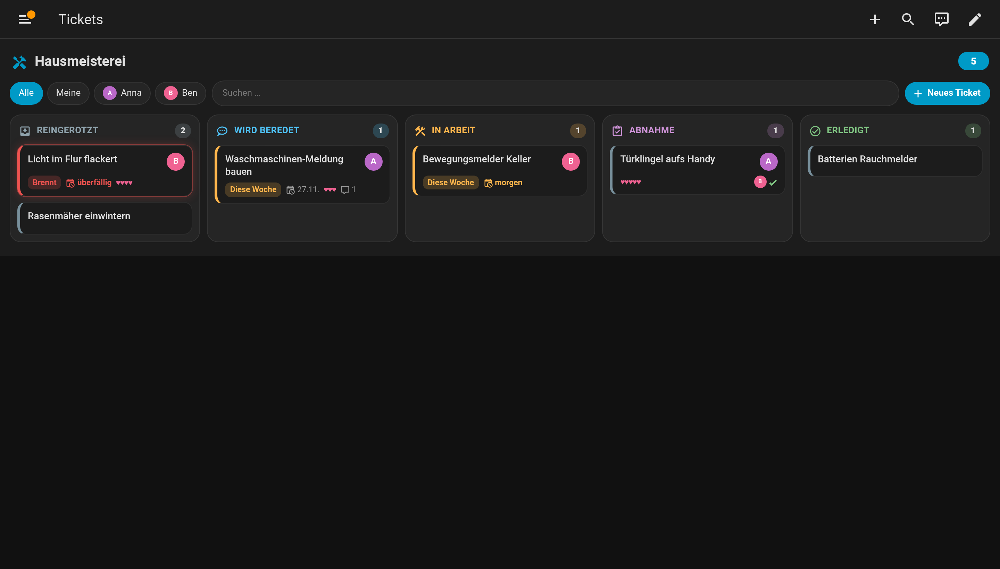
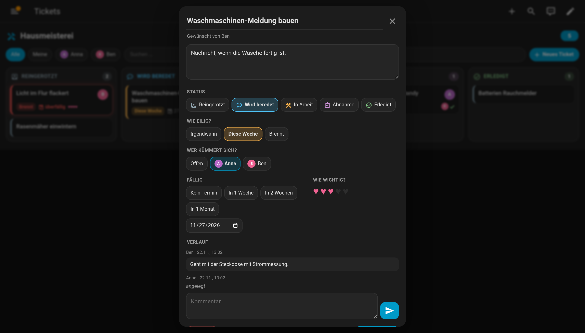

# Ticket board – everything that needs doing around the house

*[Deutsche Fassung](../ticket_board.md)*

A Kanban board for Home Assistant: wishes and tasks become tickets in columns, and you see at a glance who takes care of what, what's urgent and what's due. We call ours “Hausmeisterei” (the caretaker's office), and since then no idea gets lost.

The tickets live in a normal **Home Assistant to-do list**. No scripts, no `configuration.yaml`, and everything is part of every backup automatically. You can even see the list in the HA app.



## What it does

- **Five columns:** Inbox, Discussing, In progress, Review, Done (German labels in the screenshots). On a PC, drag cards between columns; on a phone, tap and pick the status.
- **How urgent:** Someday, This week, Urgent. Urgent tickets glow red.
- **Who takes care:** with the picture of the person in Home Assistant. Filters for All, Mine or per person.
- **Due date:** with quick picks “in 1 week”, “in 2 weeks”, “in 1 month”. Overdue tickets are marked red.
- **How important:** up to five hearts.
- **History and comments:** every status change with name and time, plus comments like in a chat.
- **Review:** in the Review column the card shows who asked for the ticket – they check whether it's done right.
- **Archive:** Done shows the newest six, the rest is one tap away. Nothing gets deleted.
- **English and German,** following your Home Assistant language. Light and dark, following your theme.



## 1. Create a to-do list

*Settings → Devices & services → Add integration* → **Local To-do** → name e.g. “Household”. You then have the entity `todo.household`.

## 2. Install the card

1. Download [`ticket-board-card.js`](../../karten/ticket-board/ticket-board-card.js) (“Download raw file” at the top right).
2. Copy it to `/config/www/` in Home Assistant, e.g. with the *File editor* or *Samba* app. Create the `www` folder if it doesn't exist yet.
3. *Settings → Dashboards → ⋮ → Resources → Add resource*: URL `/local/ticket-board-card.js?v=1`, type **JavaScript module**.
4. Reload the browser or app once.

For a new version, replace the file and increase the number after `?v=` in the resource, otherwise the browser keeps the old one.

## 3. Add the card

Edit dashboard → *Add card* → at the very bottom **Manual** → paste:

```yaml
type: custom:ticket-board-card
entity: todo.household
titel: Household
personen:
  - person.anna
  - person.ben
```

- `entity` – your to-do list (required)
- `titel` – heading above the board (*title*)
- `personen` – who can take on tickets (*persons*). Without these lines there are no assignees and no person filters.
- `archiv` – how many done tickets are visible (*archive*, default 6)

The card fits best in a **Panel** view or a full-width section.

## Good to know

- **Whoever creates a ticket is saved as “requested by”.** For that, the HA user has to be linked to their person (*Settings → People*). Otherwise the user name is shown.
- **The extra data** (status, priority, history …) is stored at the end of the to-do item's description after a ⚙. If you open the list in the HA app you'll see it there – please don't edit that line by hand.
- **Done** also ticks the item in the to-do list. If someone ticks an item in the app, it moves to Done on the board.
- **Photos and files** aren't supported by the card. Our own system has a folder per ticket on the NAS for that, but it's a lot more work.

## Not working?

| Problem | Solution |
|---|---|
| “Custom element doesn't exist” | Resource added (step 2.3)? Then reload the browser or app. |
| Board stays empty with an error | Is the to-do list name under `entity` correct? |
| “Mine” shows nothing | Is your HA user linked to your person? |
| The old version is shown | Increase the number after `?v=` in the resource, then reload. |

---

**Like it?** A ⭐ on [GitHub](https://github.com/johnkily/ha-blueprints) helps others find it – questions and wishes welcome as an [issue](https://github.com/johnkily/ha-blueprints/issues) or under [Ideas](https://github.com/johnkily/ha-blueprints/discussions/categories/ideas).
