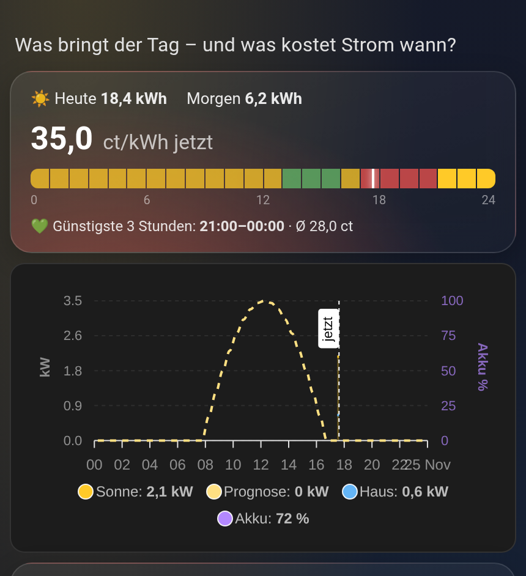
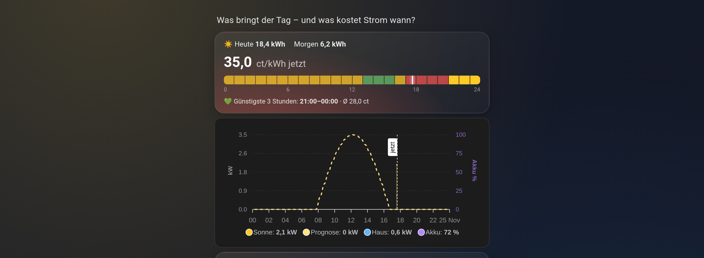

# Prognose mit Preisband – was bringt der Tag, und was kostet Strom wann?

*[English version](en/energie_prognose.md)*

Eine Seite aus unserem Energie-Karussell zum Nachbauen: oben die Solar-Prognose für heute und morgen, darunter der Strompreis des Tages als **farbiges Band** (grün günstig, gelb mittel, rot teuer) mit den **günstigsten Stunden**, die noch kommen. Darunter die **Tageskurve**: was das Dach erzeugt, was das Haus braucht, der Akku und gestrichelt die Prognose.



## Was du brauchst

| | |
|---|---|
| **button-card** und **apexcharts-card** | beide aus dem Marketplace (früher HACS): [](https://my.home-assistant.io/redirect/hacs_repository/?owner=custom-cards&repository=button-card&category=plugin) [](https://my.home-assistant.io/redirect/hacs_repository/?owner=RomRider&repository=apexcharts-card&category=plugin) |
| **Einen Strompreis-Sensor mit Preisliste** | z. B. Tibber, Nord Pool oder EPEX Spot – also ein Sensor, der die Preise des Tages als Liste im Attribut hat |
| **Solar-Prognose** *(optional)* | z. B. Solcast – für „Heute/Morgen“ und die gestrichelte Linie |
| **Das Glas-Kit** | die Vorlagen aus der [Glas-Kit-Anleitung](glas_karten.md), Schritt 1 – darin steckt auch `glas_preisband` |

## 1. Preisband

```yaml
type: custom:button-card
template: glas_preisband
entity: sensor.strompreis           # ← dein Preis-Sensor mit Liste im Attribut
variables:
  prognose_heute: sensor.solcast_pv_forecast_prognose_heute     # optional
  prognose_morgen: sensor.solcast_pv_forecast_prognose_morgen   # optional
  stunden: 3                        # Länge des günstigsten Fensters
```

Die Karte sucht die Preisliste selbst im Attribut `today`, `raw_today`, `prices`, `data` oder `forecast`. Jeder Eintrag braucht eine Startzeit (`start`, `startsAt`, `start_time` …) und einen Preis (`total`, `value`, `price` …) – in Euro oder Cent, das erkennt sie. Heißt dein Attribut anders, gib es unter `variables: attribut:` an. Viertelstunden-Preise gehen genauso.

**Woher die Liste kommt:**
- **Nord Pool** (Marketplace-Version) und **EPEX Spot** haben die Liste schon im Attribut (`raw_today` bzw. `data`).
- **Tibber**: Die offizielle Integration liefert die Preise über die Aktion `tibber.get_prices`. Mit einem Template-Sensor, der sie stündlich abholt, hast du die Liste im Attribut `today` – so machen wir es.

## 2. Tageskurve

Die fertige Karte steht in [`energie_tageskurve.yaml`](https://github.com/johnkily/ha-blueprints/blob/main/karten/glas/energie_tageskurve.yaml). Einfügen (*Karte hinzufügen → Manuell*) und die vier Entitäten ersetzen: PV-Leistung (W), Solcast „Prognose heute“, Hausverbrauch (W), Akkustand (%). Ohne Akku die letzte Serie einfach löschen. Den Block `card_mod` am Ende braucht es nur mit card-mod, er gibt der Karte die Glas-Optik.

**Achtung beim Kopieren:** Farben wie `"rgba(255,255,255,0.5)"` müssen in Anführungszeichen stehen. Ohne zerlegt YAML sie an den Kommas, und die Karte bleibt leer.



## Klappt nicht?

| Problem | Lösung |
|---|---|
| „Keine Preise im Attribut gefunden“ | Entwicklerwerkzeuge → Zustände → deinen Preis-Sensor ansehen: Wie heißt das Attribut mit der Liste? Unter `variables: attribut:` eintragen. |
| Band ist fast ganz rot | Die Farben teilen den Bereich zwischen billigstem und teuerstem Preis des Tages in Drittel – an Tagen mit kleiner Spanne sieht das schnell bunt aus, das ist richtig so. |
| Tageskurve leer | Anführungszeichen um die `rgba(...)`-Farben? Stimmen die Entitäten? |
| Prognose-Linie fehlt | Solcast-Sensor „Prognose heute“ mit Attribut `detailedForecast`? |

---

Wie das bei uns im ganzen Energie-Cockpit aussieht, steht im Blog: [Kily's World](https://kilysworld.com). Gefällt es dir? Ein ⭐ auf [GitHub](https://github.com/johnkily/ha-blueprints) hilft anderen, es zu finden.
