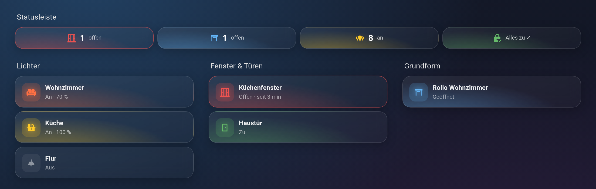
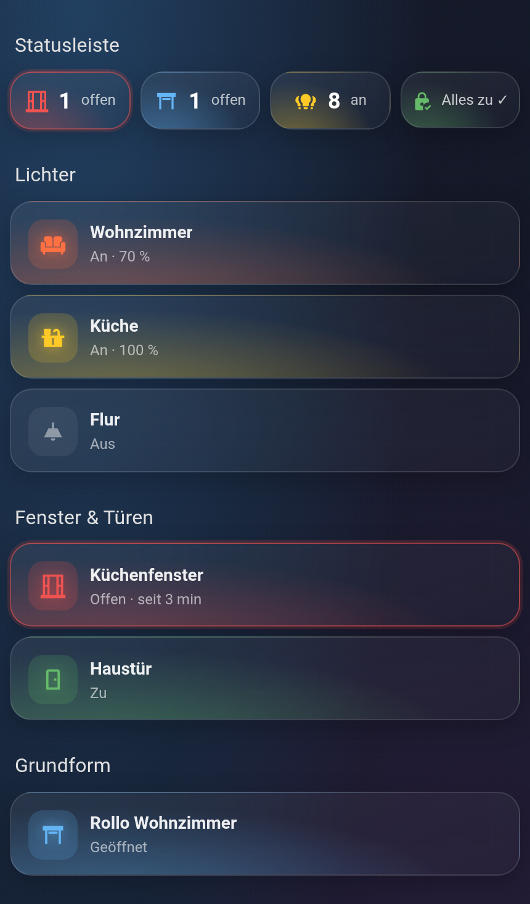

# Glas-Kit – so bekommen unsere Karten ihre Optik

*[English version](en/glas_karten.md)*

Unser Dashboard sieht nicht nach Standard aus, und danach wurde oft gefragt. Das Geheimnis sind wenige Zutaten, die überall gleich sind. Hier gibt es sie als Vorlagen für die **button-card** zum Nachbauen.



## Die vier Zutaten

| Zutat | Was dahintersteckt |
|---|---|
| **Glas** | ein leichter Weißverlauf über dem dunklen Hintergrund, ein dünner heller Rahmen, 10 px Unschärfe, ein weicher Schatten. Ecken 18 px, innen 12 px |
| **Aurora** | ein Farbschimmer von unten in der Bedeutung der Karte: amber = Licht an, rot = offen, grün = zu, blau = Rollo offen. Bei Lampen ist es die echte Farbe der Lampe |
| **Rahmen mit Bedeutung** | ein farbiger Rahmen nur, wenn er etwas sagt – sonst bleibt er hell und dezent |
| **Puls nur bei Warnungen** | ein offenes Fenster pulsiert sanft, alles andere bleibt ruhig |

Das Ganze ist für ein **dunkles Design** gedacht. Am schönsten wirkt das Glas auf einem Hintergrund mit etwas Farbe (Beispiel unten).

## Was du brauchst

| | |
|---|---|
| **button-card** | aus dem Marketplace (früher HACS) [](https://my.home-assistant.io/redirect/hacs_repository/?owner=custom-cards&repository=button-card&category=plugin) |
| **Dunkles Design** | z. B. das Standard-Design im dunklen Modus |

## 1. Vorlagen einfügen

Die Vorlagen stehen in [`glas_vorlagen.yaml`](https://github.com/johnkily/ha-blueprints/blob/main/karten/glas/glas_vorlagen.yaml). Dashboard bearbeiten → ⋮ → **Raw-Konfigurationseditor** → den ganzen Block `button_card_templates:` **ganz oben** einfügen, vor `views:`. Speichern.

## 2. Karten anlegen

Jede Karte ist eine button-card mit einer der Vorlagen (*Karte hinzufügen → Manuell*):

```yaml
# Licht: Aurora in der Lampenfarbe, Tippen schaltet, Halten öffnet Details
type: custom:button-card
template: glas_licht
entity: light.wohnzimmer
name: Wohnzimmer
icon: mdi:sofa
```

```yaml
# Fenster oder Tür: grün zu, rot und pulsierend offen, mit „seit …“
type: custom:button-card
template: glas_kontakt
entity: binary_sensor.kuechenfenster
name: Küchenfenster
icon: mdi:window-open-variant
```

```yaml
# Grundform für alles andere – Farbe als „R,G,B“
type: custom:button-card
template: glas_kachel
entity: cover.rollo_wohnzimmer
name: Rollo Wohnzimmer
icon: mdi:window-shutter-open
variables:
  farbe: "100,181,246"
```

```yaml
# Statusleiste: vier Segmente, die selbst zählen
type: grid
columns: 4
square: false
cards:
  - type: custom:button-card
    template: glas_leiste
    variables: { art: fenster }
  - type: custom:button-card
    template: glas_leiste
    variables: { art: rollos }
  - type: custom:button-card
    template: glas_leiste
    variables: { art: lichter }
  - type: custom:button-card
    template: glas_leiste
    variables: { art: schloesser }
```

Die Statusleiste zählt selbst: offene Fenster und Türen (alle Kontakte mit Geräteklasse Fenster/Tür), offene Rollos, eingeschaltete Lichter (ohne Lichtgruppen) und Schlösser, die nicht verriegelt sind. Ist nichts offen, zeigt sie „Fenster zu“, „Alles aus“ oder „Alles zu ✓“.



## 3. Hintergrund (optional)

Glas braucht etwas dahinter. In der Ansicht (*Ansicht bearbeiten → Hintergrund*) oder im Raw-Editor bei der Ansicht:

```yaml
background: >-
  radial-gradient(ellipse at 15% 0%, rgba(66,165,245,.28), transparent 55%),
  radial-gradient(ellipse at 90% 100%, rgba(171,71,188,.25), transparent 60%),
  linear-gradient(160deg, #161b2b, #0f1320)
```

## Variablen der Grundform

| Variable | Bedeutung |
|---|---|
| `farbe` | Farbe der Bedeutung als `"R,G,B"`, Vorgabe amber `"255,202,40"` |
| `aktiv` | ob die Aurora leuchtet; Vorgabe: Zustand an, offen, entriegelt, zu Hause, spielt, heizt |
| `rahmen` | `true` = farbiger Rahmen, wenn aktiv |
| `puls` | `true` = pulsiert, wenn aktiv |

Eigene Farben für alles: Solar `255,202,40`, Netz `100,181,246`, Einspeisung `102,187,106`, Akku `179,136,255`, Warnung `239,83,80`.

## Klappt nicht?

| Problem | Lösung |
|---|---|
| „Custom element doesn't exist: button-card“ | button-card aus dem Marketplace installieren, App neu laden. |
| „Template glas_licht not found“ | Die Vorlagen stehen nicht ganz oben im Raw-Editor oder in einem anderen Dashboard. Sie gelten nur für das Dashboard, in dem sie stehen. |
| Sieht flach aus | Helles Design? Das Glas ist für dunkel gemacht. Und ohne farbigen Hintergrund ist auch Glas nur grau. |

---

Wie das bei uns im ganzen Dashboard aussieht, steht im Blog: [Kily's World](https://kilysworld.com). Gefällt es dir? Ein ⭐ auf [GitHub](https://github.com/johnkily/ha-blueprints) hilft anderen, es zu finden.
