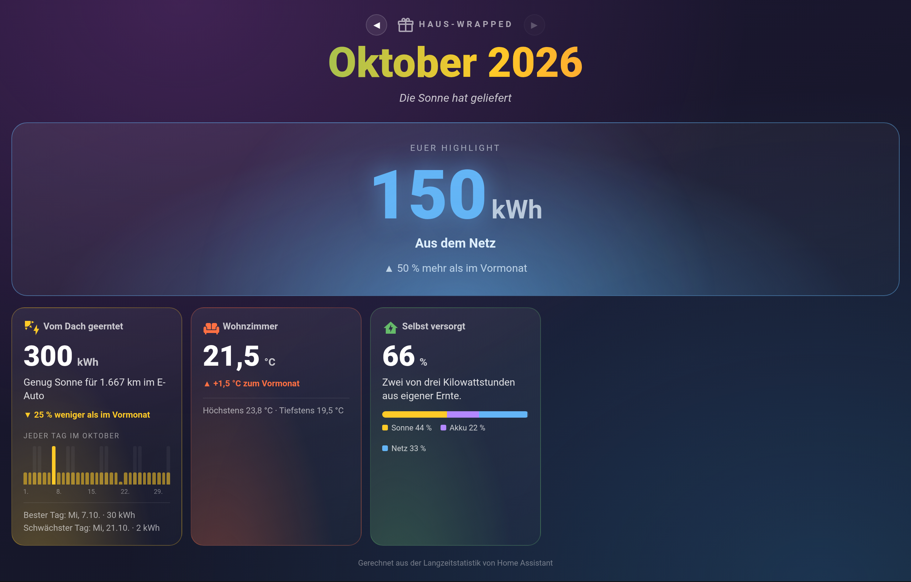

# Monatsrückblick – dein Haus-Wrapped

*[English version](en/monatsrueckblick.md)*

Spotify zeigt einem am Jahresende, was man gehört hat. Dieser Blueprint macht das jeden Monat fürs Haus. Am 1. kommt eine Nachricht mit den Zahlen des letzten Monats, mit Vergleich zum Vormonat und einem Highlight:

```
📊 Dein Haus im November
☀️ PV-Ertrag: 312 kWh (↓ 68 %)
⚡ Netzbezug: 140 kWh (↑ 35 %)
🌡️ Wohnzimmer: Ø 21,3 °C, höchstens 23,8 °C (+0,8 °C)
🚗 Das reicht für 1.733 km im E-Auto
🏆 Größte Veränderung: PV-Ertrag ↓ 68 %
```

Dazu gibt es eine [Profi-Variante](#profi-die-haus-wrapped-karte): eine eigene Karte, die den ganzen Monat als bunte Seite zeigt.

Die Zahlen kommen aus der **Langzeitstatistik** von Home Assistant. Du brauchst keine Hilfszähler und kein Skript. Jeder Sensor, der im Energie-Dashboard oder in einem Verlaufs-Diagramm über Monate auftaucht, geht.

## Was du brauchst

| | |
|---|---|
| **Home Assistant 2026.10 oder neuer** | wegen der Aktion `recorder.get_statistics` |
| **Sensoren mit Statistik** | z. B. PV-Ertrag, Netzbezug, Einspeisung, Wärmepumpe, Gas, Wasser, Temperaturen |
| **Handy** *(optional)* | die Home-Assistant-App für die Nachricht |

## 1. Blueprint importieren

[](https://my.home-assistant.io/redirect/blueprint_import/?blueprint_url=https%3A%2F%2Fgithub.com%2Fjohnkily%2Fha-blueprints%2Fblob%2Fmain%2Fblueprints%2Fautomation%2Fhaus%2Fmonatsrueckblick.yaml)

## 2. Automation anlegen

*Einstellungen → Automationen & Szenen → Blueprints* → **Monatsrückblick – dein Haus-Wrapped**

| Feld | Was eintragen |
|---|---|
| Sensoren für den Rückblick | fünf bis acht Sensoren, die Reihenfolge ist die in der Nachricht |
| Uhrzeit am 1. des Monats | Vorgabe 10 Uhr |
| Vergleich zum Vormonat | Pfeil mit Prozent bei Zählern, Differenz bei Messwerten |
| Umrechnen in E-Auto-Kilometer | z. B. der PV-Ertrag, dazu der Verbrauch deines Autos (Vorgabe 18 kWh/100 km) |
| Handys / Auch in Home Assistant / Eigenes Skript | wohin die Nachricht geht |
| Dashboard-Pfad | Antippen der Nachricht öffnet z. B. dein Energie-Dashboard |

**Zum Ausprobieren**, ohne bis zum 1. zu warten: Automation öffnen → ⋮ → **Ausführen**. Dann kommt der Rückblick für den letzten Monat sofort.

## Wie rechnet er?

- **Zähler** (kWh, m³, €, alles, was nur wächst) → Summe im Monat, Vergleich in Prozent.
- **Messwerte** (°C, %, W) → Durchschnitt und Höchstwert, Vergleich als Differenz.
- **Highlight** ist der Zähler mit der größten Veränderung zum Vormonat.
- Sensoren ohne Werte im letzten Monat (z. B. gerade erst angelegt) lässt er einfach weg.
- Das Symbol sucht er selbst aus: ☀️ bei PV/Solar im Namen, 🔋 bei Akku, ⚡ Energie, 🌡️ Temperatur, 💧 Feuchte, 🔥 Gas, 🚿 Wasser, 💶 Geld.

## Profi: die Haus-Wrapped-Karte

Die Nachricht ist schön, aber unser eigenes Haus-Wrapped ist eine ganze Seite im Dashboard. Die gibt es als eigene Karte zum Nachbauen:



- großer Monatsname mit Farbverlauf und darunter das **Highlight des Monats**
- je Sensor eine Kachel mit Vergleich zum Vormonat, **bestem und schwächstem Tag** bzw. Höchst- und Tiefstwert
- auf Wunsch **Tagesbalken** („Jeder Tag im Oktober“) und ein **Herkunfts-Balken** (Sonne, Akku, Netz)
- mit ◀ ▶ durch die Monate blättern
- die Karte rechnet selbst aus der Langzeitstatistik – kein Skript, kein Hilfssensor, auch nicht der Blueprint oben
- Deutsch und Englisch, je nach Sprache von Home Assistant

### Installieren

**Über den Marketplace (früher HACS), empfohlen** – Updates kommen dann per Klick:

[](https://my.home-assistant.io/redirect/hacs_repository/?owner=johnkily&repository=haus-wrapped-card&category=plugin)

Der Knopf öffnet die Karte im Marketplace → **Herunterladen**, danach Browser bzw. App neu laden.

**Oder von Hand:**

1. Die Datei [`haus-wrapped-card.js`](https://github.com/johnkily/haus-wrapped-card/blob/main/haus-wrapped-card.js) herunterladen und nach `/config/www/` kopieren.
2. *Einstellungen → Dashboards → ⋮ → Ressourcen → Ressource hinzufügen*: `/local/haus-wrapped-card.js?v=1`, Typ **JavaScript-Modul**.
3. Browser bzw. App neu laden.

### Einfügen

Am besten auf eine eigene Seite im Dashboard, Ansichtstyp **Panel**. *Karte hinzufügen → Manuell*:

```yaml
type: custom:haus-wrapped-card
motto: Die Sonne hat geliefert
kacheln:
  - entity: sensor.pv_ertrag
    titel: Vom Dach geerntet
    icon: mdi:solar-power
    farbe: "#ffca28"
    satz: Genug Sonne für {km} km im E-Auto
    verlauf: true
  - entity: sensor.netzbezug
    titel: Aus dem Netz
    icon: mdi:transmission-tower
  - entity: sensor.wohnzimmer_temperatur
    titel: Wohnzimmer
    icon: mdi:sofa
  - titel: Selbst versorgt
    icon: mdi:home-lightning-bolt
    satz: Zwei von drei Kilowattstunden aus eigener Ernte.
    anteile:
      - { entity: sensor.pv_eigenverbrauch, name: Sonne, farbe: "#ffca28", eigen: true }
      - { entity: sensor.akku_entladen, name: Akku, farbe: "#b388ff", eigen: true }
      - { entity: sensor.netzbezug, name: Netz, farbe: "#64b5f6" }
```

| Option | Bedeutung |
|---|---|
| `kacheln` | die Kacheln, in dieser Reihenfolge |
| `entity` | Sensor mit Langzeitstatistik |
| `titel`, `icon`, `farbe` | Überschrift, Symbol, Farbe der Kachel (Farbe sonst automatisch) |
| `satz` | ein Satz unter der Zahl, mit Platzhaltern `{wert}`, `{einheit}`, `{km}` (Wert ÷ `eauto_verbrauch` × 100, Vorgabe 18 kWh/100 km) und `{vormonat}` |
| `verlauf: true` | Tagesbalken für den Monat |
| `anteile` | statt `entity`: mehrere Zähler als Herkunfts-Balken; die große Zahl ist die Summe der Teile mit `eigen: true` |
| `highlight: true` | diese Kachel als Highlight; sonst nimmt die Karte die mit der größten Veränderung |
| `art: summe` / `art: mittel` | nur nötig, wenn die Karte Zähler und Messwert falsch erkennt (englisch: `type: sum` / `type: mean`) |
| `motto`, `titel` | Text unter dem Monat bzw. statt „HAUS-WRAPPED“ |

**Zusammen mit dem Blueprint:** Stell im Blueprint unter „Dashboard-Pfad“ die Seite mit der Karte ein. Dann kommt am 1. die Nachricht, und ein Tipp darauf öffnet den ganzen Rückblick.

## Klappt nicht?

| Problem | Lösung |
|---|---|
| Ein Sensor fehlt in der Nachricht | Hat er eine Langzeitstatistik? Im Verlauf muss er über Monate zu sehen sein (`state_class` gesetzt). Ganz neue Sensoren haben noch keinen vollen Monat. |
| Werte wirken zu hoch | Zähler, die sich zwischendurch zurücksetzen, brauchen `state_class: total_increasing`. |
| Fehler beim Import | Home Assistant älter als 2026.10 – dort gibt es `recorder.get_statistics` noch nicht. |

---

Unser eigenes Haus-Wrapped ist eine ganze Dashboard-Seite mit Waschgängen, Mähroboter und Tickets – wie es aussieht, steht im Blog: [Kily's World](https://kilysworld.com). Gefällt dir der Blueprint? Ein ⭐ auf [GitHub](https://github.com/johnkily/ha-blueprints) hilft anderen, ihn zu finden.
