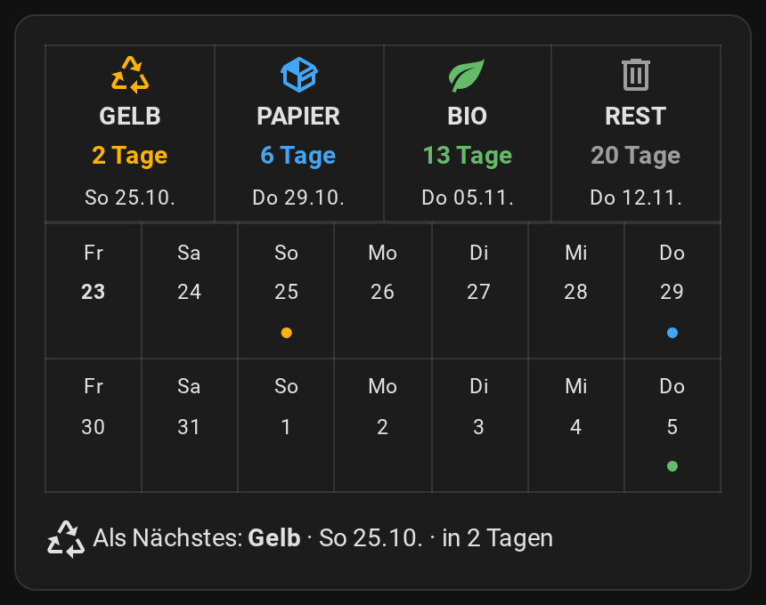
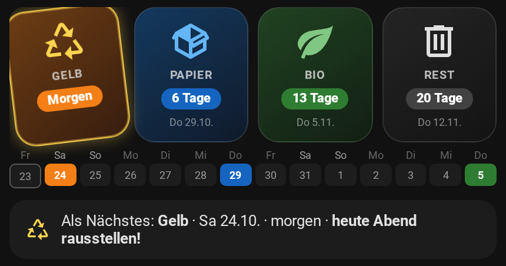

# Müll: Kachel-Karte, Erinnerung und Ampel

Alles aus einem Abfallkalender – ohne HACS, ohne `configuration.yaml`:

- **Kachel-Karte** fürs Dashboard: vier Tonnen mit „in 6 Tagen“, darunter zwei Wochen als Mini-Kalender mit farbigen Punkten und „Als Nächstes“ – wahlweise als [Profi-Variante](#profi-variante-unsere-karte-mit-button-card) mit farbigen Kacheln (button-card).
- **Erinnerung am Vorabend** (Blueprint): „🟦 Papier, 🟨 Gelber Sack – bitte heute Abend rausstellen.“
- **Müll-Ampel** auf der AWTRIX-Pixeluhr (Blueprint): siehe [AWTRIX-Anleitung](awtrix.md#müll-ampel).



## 1. Abfallkalender einbinden

Fast jede Stadt oder jeder Entsorger bietet den Abfuhrkalender als **ICS-Datei** oder **Kalender-Abo** an (Suchbegriffe: „Abfallkalender ICS“ + Stadtname).

1. Den Link zur ICS-Datei kopieren (er endet meist auf `.ics`).
2. In Home Assistant: *Einstellungen → Geräte & Dienste → Integration hinzufügen* → **Remote Calendar**.
3. Name „Abfall“ eintragen und den Link einfügen. Der Kalender heißt dann `calendar.abfall`.

Alternativ liefert die HACS-Integration [Waste Collection Schedule](https://github.com/mampfes/hacs_waste_collection_schedule) für sehr viele Städte direkt einen Kalender.

## 2. Kachel-Karte

Die Karte braucht die Termine **je Tonne**. Die sammelt ein Blueprint in einem Text-Helfer.

**a) Helfer anlegen:** *Einstellungen → Geräte & Dienste → Helfer → Helfer erstellen → **Text***. Name **Müll-Plan**, maximale Länge **255**. (Home Assistant nennt ihn dann `input_text.mull_plan` – das „ü“ wird zu „u“.)

**b) Blueprint „Müll – Plan für die Kachel-Karte“:**

[](https://my.home-assistant.io/redirect/blueprint_import/?blueprint_url=https%3A%2F%2Fgithub.com%2Fjohnkily%2Fha-blueprints%2Fblob%2Fmain%2Fblueprints%2Fautomation%2Fmuell%2Fmuell_plan.yaml)

Unter *Einstellungen → Automationen & Szenen → Blueprints* öffnen, **Abfallkalender** und den Helfer **Müll-Plan** auswählen, speichern. Er aktualisiert sich alle drei Stunden, nach Mitternacht und beim Start von Home Assistant.

**c) Karte einfügen:** Dashboard → **Bearbeiten** → **Karte hinzufügen** → ganz unten **Manuell** → alles hineinkopieren → **Speichern**.

```yaml
# Müll-Kachel-Karte für Home Assistant – nur die eingebaute Markdown-Karte, kein HACS.
# Braucht den Text-Helfer „Müll-Plan“ (input_text.mull_plan), den der Blueprint
# „Müll – Plan für die Kachel-Karte“ füllt.
# Einfügen: Dashboard bearbeiten → Karte hinzufügen → ganz unten „Manuell“ →
# alles hier hineinkopieren → Speichern. Heißt dein Helfer anders, Zeile 14 anpassen.
# Anleitung: https://github.com/johnkily/ha-blueprints/blob/main/docs/muell.md
type: markdown
content: |
  
  
  
  
  
  
  
    
    
  
  
  
  Noch keine Abholtermine – läuft der Blueprint „Müll – Plan für die Kachel-Karte“?
  
  <table width="100%"><tr>
  
  <td align="center" width="25%"><font color="{{ c.farbe }}"><ha-icon icon="{{ c.icon }}"></ha-icon></font><br><b>{{ c.name | upper }}</b><br><font color="{{ c.farbe }}"><b>HeuteMorgen{{ t.tage }} Tage</b></font><br><small>{{ wt[t.tag.weekday()] }} {{ t.tag.strftime('%d.%m.') }}</small></td>
  
  </tr></table>

  <table width="100%">
  <tr>
  
  <td align="center" width="14%"><small>{{ wt[d.weekday()] }}<br><b>{{ d.day }}</b>{{ d.day }}</small><br><font color="{{ tonnen[s[10:]].farbe }}">●</font>&nbsp;</td>
  </tr>
  
  </table>

  
  <ha-icon icon="{{ c.icon }}"></ha-icon> Als Nächstes: **{{ c.name }}** · {{ wt[n.tag.weekday()] }} {{ n.tag.strftime('%d.%m.') }} · heutemorgenin {{ n.tage }} Tagen
  

  <ha-alert alert-type="warning">Heute Abend rausstellen!</ha-alert>
  
  
```

Die Tonnen sind nach der nächsten Abholung sortiert. Nachmittags vor einer Abholung erscheint „Heute Abend rausstellen!“.

### Ohne Helfer: die schlichte Variante

Wer keinen Helfer anlegen möchte: Diese Karte liest den nächsten Termin direkt aus dem Kalender (nur die nächste Tonne, darunter die Wochenliste).

<details><summary>Schlichte Karte anzeigen</summary>

```yaml
# Müll-Karte für Home Assistant – nur eingebaute Karten, kein HACS.
# Einfügen: Dashboard bearbeiten → Karte hinzufügen → ganz unten „Manuell“ →
# alles hier hineinkopieren → in Zeile 11 und 38 „calendar.abfall“ durch deinen
# Abfallkalender ersetzen → Speichern.
# Anleitung: https://github.com/johnkily/ha-blueprints/blob/main/docs/muell.md
type: vertical-stack
cards:
  - type: markdown
    title: 🗑️ Müllabfuhr
    content: |
      
      
      
      
      
      
      
      
      
      
      
      
      
      ## {{ z }} {{ titel }}

      **HeuteMorgenIn {{ tage }} Tagen** · {{ wt }}, {{ tag.strftime('%d.%m.') }}
      
      <ha-alert alert-type="warning">Heute Abend rausstellen!</ha-alert>
      
      <ha-alert alert-type="info">Heute ist Abholung.</ha-alert>
      
      
      Kein Termin im Kalender.
      
  - type: calendar
    initial_view: listWeek
    entities:
      - calendar.abfall
```

</details>

### Profi-Variante: unsere Karte mit button-card

So sieht die Karte bei uns zu Hause aus – farbige Kacheln, die nächste Tonne leuchtet, bei „Morgen“ wackelt sie, darunter zwei Wochen als farbige Kästchen:



Sie nutzt **dieselben Daten** wie die Kachel-Karte oben (Helfer *Müll-Plan* + Blueprint *Müll – Plan*), braucht aber die Frontend-Erweiterung **button-card** aus HACS. Einen Template-Sensor oder YAML-Dateien braucht sie nicht.

1. **HACS** installieren, falls noch nicht vorhanden: [Anleitung auf hacs.xyz](https://hacs.xyz/docs/use/download/download/).
2. **button-card** installieren: [](https://my.home-assistant.io/redirect/hacs_repository/?owner=custom-cards&repository=button-card&category=plugin) → **Herunterladen** → danach die Seite im Browser neu laden (bzw. die App neu starten).
3. Helfer **Müll-Plan** und Blueprint **Müll – Plan** wie in Schritt 2a und 2b einrichten (falls noch nicht geschehen).
4. Karte einfügen: Dashboard → **Bearbeiten** → **Karte hinzufügen** → **Manuell** → den Code unten hineinkopieren → **Speichern**.

<details><summary>Code der Profi-Karte anzeigen</summary>

```yaml
# Müll-Kachel-Karte – Profi-Variante (so sieht sie bei uns aus)
# Braucht: HACS-Frontend-Erweiterung „button-card“ und den Text-Helfer
# „Müll-Plan“ (input_text.mull_plan), gefüllt vom Blueprint
# „Müll – Plan für die Kachel-Karte“. Keine YAML-Dateien, kein Template-Sensor.
# Einfügen: Dashboard bearbeiten → Karte hinzufügen → „Manuell“ → hineinkopieren.
# Heißt dein Helfer anders, Zeile 9 anpassen.
# Anleitung: https://github.com/johnkily/ha-blueprints/blob/main/docs/muell.md#profi-variante
type: custom:button-card
entity: input_text.mull_plan
# sun.sun ändert sich alle paar Minuten – so zählt die Karte auch nach Mitternacht richtig weiter
triggers_update:
  - sun.sun
show_name: false
show_icon: false
show_state: false
tap_action:
  action: none
styles:
  card:
    - padding: 0
    - background: none
    - border: none
    - box-shadow: none
  grid:
    - grid-template-areas: '"muell"'
    - grid-template-columns: 1fr
  custom_fields:
    muell:
      - width: 100%
extra_styles: |
  @keyframes muell-wackeln {
    0% { transform: rotate(0deg); } 25% { transform: rotate(-8deg); }
    50% { transform: rotate(8deg); } 75% { transform: rotate(-4deg); } 100% { transform: rotate(0deg); }
  }
  @keyframes muell-leuchten {
    0%, 100% { box-shadow: inset 0 0 0 1px rgba(255,255,255,.25), 0 0 2px rgba(255,255,255,.1); }
    50% { box-shadow: inset 0 0 0 1px rgba(255,255,255,.45), 0 0 16px var(--glow-color); }
  }
custom_fields:
  muell: |
    [[[
      const TONNEN = {
        p: { name: 'Papier', icon: 'mdi:package-variant', farbe: '#64b5f6', glow: '100,181,246', pill: '#1565c0',
             bg: 'linear-gradient(145deg, rgba(25,118,210,.4) 0%, rgba(13,71,161,.18) 100%)' },
        b: { name: 'Bio', icon: 'mdi:leaf', farbe: '#81c784', glow: '129,199,132', pill: '#2e7d32',
             bg: 'linear-gradient(145deg, rgba(56,142,60,.4) 0%, rgba(27,94,32,.18) 100%)' },
        g: { name: 'Gelb', icon: 'mdi:recycle-variant', farbe: '#ffd54f', glow: '255,213,79', pill: '#f57f17',
             bg: 'linear-gradient(145deg, rgba(245,127,23,.4) 0%, rgba(230,81,0,.18) 100%)' },
        r: { name: 'Rest', icon: 'mdi:trash-can-outline', farbe: '#e0e0e0', glow: '200,200,200', pill: '#424242',
             bg: 'linear-gradient(145deg, rgba(66,66,66,.4) 0%, rgba(33,33,33,.18) 100%)' }
      };
      const WT = ['So', 'Mo', 'Di', 'Mi', 'Do', 'Fr', 'Sa'];
      const roh = (entity && entity.state) || '';
      if (!roh.includes('|')) {
        return '<div style="white-space:normal;opacity:.6;padding:12px;">Noch keine Abholtermine – läuft der Blueprint „Müll – Plan für die Kachel-Karte“?</div>';
      }
      const teile = roh.split('|');
      const heute = new Date(); heute.setHours(0, 0, 0, 0);
      const datum = (iso) => new Date(iso + 'T00:00:00');
      const liste = teile[0].trim().split(/\s+/).filter(x => TONNEN[x[0]])
        .map(x => ({ k: x[0], d: datum(x.slice(1)) }))
        .map(t => ({ ...t, tage: Math.round((t.d - heute) / 86400000) }))
        .sort((a, b) => a.tage - b.tage);
      if (!liste.length) return '<div style="opacity:.6;padding:12px;">Keine Abholtermine.</div>';

      let kacheln = '';
      liste.forEach((t, i) => {
        const c = TONNEN[t.k];
        let label = t.tage + ' Tage';
        let tag = WT[t.d.getDay()] + ' ' + t.d.getDate() + '.' + (t.d.getMonth() + 1) + '.';
        let rand = '1px solid rgba(127,127,127,.25)';
        let extra = '';
        if (i === 0) {
          rand = '1px solid rgba(' + c.glow + ',.9)';
          extra = 'box-shadow:inset 0 0 0 1px rgba(' + c.glow + ',.45),0 0 12px rgba(' + c.glow + ',.4);';
        }
        if (t.tage <= 0) {
          label = 'Heute'; tag = ''; rand = '2px solid rgba(255,255,255,.85)';
          extra = 'animation:muell-wackeln 1s ease-in-out infinite,muell-leuchten 2s infinite;--glow-color:' + c.farbe + ';';
        } else if (t.tage === 1) {
          label = 'Morgen'; tag = '';
          extra += 'animation:muell-wackeln 2.5s ease-in-out infinite;';
        }
        kacheln += '<div style="flex:1;min-width:0;background:' + c.bg + ';border:' + rand + ';border-radius:18px;'
          + 'display:flex;flex-direction:column;align-items:center;justify-content:center;gap:6px;padding:8px 2px;'
          + 'height:115px;box-sizing:border-box;' + extra + '">'
          + '<ha-icon icon="' + c.icon + '" style="--mdc-icon-size:36px;color:' + c.farbe + ';margin:0;"></ha-icon>'
          + '<div style="font-size:10px;font-weight:700;letter-spacing:.5px;text-transform:uppercase;opacity:.8;line-height:1;">' + c.name + '</div>'
          + '<div style="background:' + c.pill + ';color:#fff;font-size:11px;font-weight:800;padding:2px 9px;border-radius:12px;line-height:1.3;">' + label + '</div>'
          + '<div style="font-size:9px;opacity:.55;line-height:1.2;min-height:11px;">' + tag + '</div></div>';
      });

      const termine = (teile[1] || '').trim().split(/\s+/).filter(Boolean);
      let band = '';
      for (let i = 0; i < 14; i++) {
        const d = new Date(heute); d.setDate(d.getDate() + i);
        const iso = d.getFullYear() + '-' + String(d.getMonth() + 1).padStart(2, '0') + '-' + String(d.getDate()).padStart(2, '0');
        const treffer = termine.find(s => s.slice(0, 10) === iso && TONNEN[s.slice(10)]);
        const we = d.getDay() === 0 || d.getDay() === 6;
        band += '<div style="flex:1;min-width:0;text-align:center;">'
          + '<div style="font-size:9px;opacity:' + (we ? .65 : .4) + ';line-height:1;">' + WT[d.getDay()] + '</div>'
          + '<div style="height:19px;margin-top:2px;border-radius:5px;background:' + (treffer ? TONNEN[treffer.slice(10)].pill : 'rgba(127,127,127,.12)') + ';'
          + (i === 0 ? 'border:1px solid rgba(127,127,127,.6);' : '')
          + 'display:flex;align-items:center;justify-content:center;font-size:9px;font-weight:' + (treffer ? 700 : 400) + ';'
          + 'color:' + (treffer ? '#fff' : 'var(--secondary-text-color)') + ';">' + d.getDate() + '</div></div>';
      }

      const n = liste[0];
      const c = TONNEN[n.k];
      const wann = n.tage <= 0 ? 'heute' : (n.tage === 1 ? 'morgen' : 'in ' + n.tage + ' Tagen');
      const hinweis = (n.tage === 1 && new Date().getHours() >= 15) ? ' · <b>heute Abend rausstellen!</b>' : '';
      const zeile = '<div style="display:flex;align-items:center;gap:10px;margin-top:10px;padding:10px 14px;border-radius:14px;'
        + 'background:rgba(127,127,127,.1);font-size:13px;text-align:left;">'
        + '<ha-icon icon="' + c.icon + '" style="--mdc-icon-size:20px;color:' + c.farbe + ';margin:0;"></ha-icon>'
        + '<span>Als Nächstes: <b>' + c.name + '</b> · ' + WT[n.d.getDay()] + ' ' + n.d.getDate() + '.' + (n.d.getMonth() + 1) + '. · ' + wann + hinweis + '</span></div>';

      return '<div style="white-space:normal;width:100%;">'
        + '<div style="display:flex;gap:8px;">' + kacheln + '</div>'
        + '<div style="margin-top:7px;display:flex;gap:3px;">' + band + '</div>' + zeile + '</div>';
    ]]]
```

</details>

Farben, Icons und Namen stehen oben im Code im Block `TONNEN` – dort lassen sie sich anpassen. Die Karte funktioniert im hellen und im dunklen Design.

## 3. Erinnerung am Vorabend

[](https://my.home-assistant.io/redirect/blueprint_import/?blueprint_url=https%3A%2F%2Fgithub.com%2Fjohnkily%2Fha-blueprints%2Fblob%2Fmain%2Fblueprints%2Fautomation%2Fmuell%2Fmuell_erinnerung.yaml)

*Einstellungen → Automationen & Szenen → Blueprints* → **Müll – Erinnerung am Vorabend**.

| Feld | Was eintragen |
|---|---|
| Abfallkalender | `calendar.abfall` |
| Uhrzeit | Vorgabe 19:00 |
| Handys | wer erinnert werden soll |
| Nur Handys, die zu Hause sind | Vorgabe aus – wer unterwegs ist, weiß dann trotzdem Bescheid |
| Tonnen *(aufklappen)* | Stichwörter je Tonne, falls dein Kalender die Tonnen anders nennt |

Stehen mehrere Tonnen an, kommen alle in eine Nachricht. Einträge, die zu keiner Tonne passen (z. B. „Sperrmüll“), erscheinen mit ihrem eigenen Namen.

## Tonnen und Stichwörter

| Tonne | Farbe | erkannt an (Groß-/Kleinschreibung egal) |
|---|---|---|
| Papier | blau | Papier, Blau, PPK |
| Gelber Sack / Wertstoff | gelb | Gelb, Wertstoff, Verpackung, Leichtverpackung |
| Bio | grün | Bio, Grün, Braun, Kompost |
| Restmüll | grau | Rest, Grau, Schwarz |

Heißen die Termine in deinem Kalender anders, die Stichwörter im Blueprint (Abschnitt *Tonnen*) ergänzen.

## Klappt nicht?

| Problem | Lösung |
|---|---|
| „Noch keine Abholtermine“ | Läuft der Blueprint *Müll – Plan*? Einmal in der Automation oben rechts auf **Ausführen** tippen. Heißt der Helfer anders als `input_text.mull_plan`, in Zeile 14 der Karte anpassen. |
| Eine Tonne fehlt | Der Kalender nennt sie anders – Stichwort ergänzen (siehe oben). |
| Keine Erinnerung | *Automation → Traces*: Ist morgen ein Termin im Kalender? |
