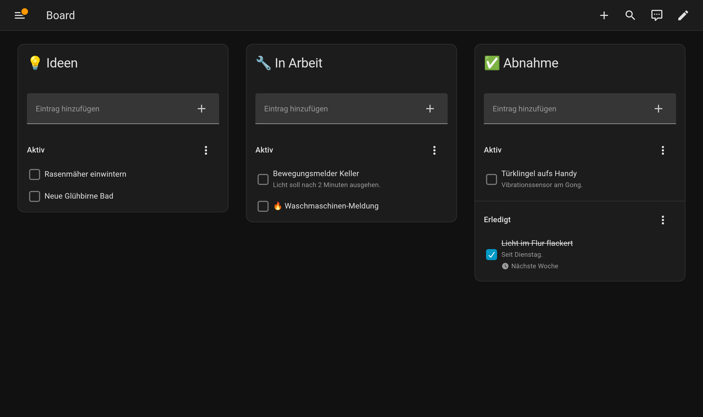
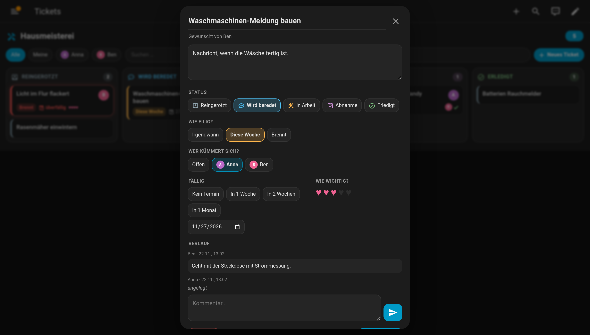

# Ticket-Board – alles, was im Haus zu tun ist

*[English version](en/ticket_board.md)*

Ein Kanban-Board für Home Assistant: Wünsche und Aufgaben landen als Ticket in Spalten, man sieht auf einen Blick, wer sich kümmert, was brennt und was fällig ist. Bei uns heißt das „Hausmeisterei“, und seitdem bleibt keine Idee mehr liegen.

Die Tickets liegen in einer ganz normalen **To-do-Liste von Home Assistant**. Keine Skripte, keine `configuration.yaml`, und alles steckt automatisch in jeder Sicherung. Die Liste siehst du sogar in der HA-App.

**Zwei Varianten:**

- **[Einfach](#einfach-ohne-installation)** – zwei oder drei To-do-Listen nebeneinander, nur eingebaute Karten. Abhaken schiebt einen Eintrag in die nächste Spalte. In fünf Minuten fertig, nichts zu installieren.
- **[Profi](#profi-das-ticket-board)** – ein richtiges Board mit Prioritäten, Zuständigen mit Foto, Filtern, Verlauf und Kommentaren. Dafür einmal eine Datei installieren.

Die Profi-Karte übernimmt die Einträge der einfachen Variante nicht automatisch. Wer später wechselt, legt die offenen Tickets einmal neu an.

## Einfach (ohne Installation)



**1. Listen anlegen:** *Einstellungen → Geräte & Dienste → Integration hinzufügen* → **Lokale To-do-Liste**, das Ganze zwei- oder dreimal, z. B. „Ideen“, „In Arbeit“ und „Abnahme“.

**2. Blueprint importieren:**

[](https://my.home-assistant.io/redirect/blueprint_import/?blueprint_url=https%3A%2F%2Fgithub.com%2Fjohnkily%2Fha-blueprints%2Fblob%2Fmain%2Fblueprints%2Fautomation%2Ftickets%2Fticket_board_einfach.yaml)

*Einstellungen → Automationen & Szenen → Blueprints* → **Ticket-Board einfach – Abhaken schiebt weiter**: die Listen in der Reihenfolge eintragen. Unter „Nachricht, wenn etwas in der letzten Spalte landet“ auf Wunsch die Handys, dann weiß der Wünschende, dass er nachschauen kann.

**3. Karten einfügen:** für jede Liste eine **To-do-Liste**-Karte (*Karte hinzufügen → To-do-Liste*), am besten nebeneinander in einer Abschnitts-Ansicht.

**So arbeitet man damit:** Neues kommt in „Ideen“ (auch per Sprachassistent: „Füge Glühbirne Bad zu Ideen hinzu“). Abhaken schiebt in „In Arbeit“, dort abhaken schiebt in „Abnahme“. Abgehakt in der letzten Liste ist erledigt – der Eintrag bleibt unter „Erledigt“ stehen, bis man ihn löscht. Beschreibung und Fälligkeit wandern mit. Was brennt, bekommt ein 🔥 vor den Titel.

## Profi: das Ticket-Board


### Was es kann

- **Fünf Spalten:** Reingerotzt, Wird beredet, In Arbeit, Abnahme, Erledigt. Am PC einfach Karten zwischen den Spalten ziehen, am Handy tippen und den Status wählen.
- **Wie eilig:** Irgendwann, Diese Woche, Brennt. Brennende Tickets leuchten rot.
- **Wer kümmert sich:** mit Foto aus der Person in Home Assistant. Filter für Alle, Meine oder je Person.
- **Fällig:** mit Schnellwahl „in 1 Woche“, „in 2 Wochen“, „in 1 Monat“. Überfällige Tickets sind rot markiert.
- **Wie wichtig:** bis zu fünf Herzchen.
- **Verlauf und Kommentare:** jede Statusänderung mit Name und Uhrzeit, dazu Kommentare wie in einem Chat.
- **Abnahme:** In der Spalte Abnahme zeigt die Karte, wer sich das Ticket gewünscht hat. Der schaut dann, ob es passt.
- **Archiv:** Erledigt zeigt die neuesten sechs, der Rest ist einen Tipp entfernt. Gelöscht wird nichts.
- **Deutsch und Englisch,** passend zur Sprache in Home Assistant. Hell und dunkel, passend zum Theme.



### 1. To-do-Liste anlegen

*Einstellungen → Geräte & Dienste → Integration hinzufügen* → **Lokale To-do-Liste** → Name z. B. „Hausmeisterei“. Danach gibt es die Entität `todo.hausmeisterei`.

### 2. Karte installieren

1. Die Datei [`ticket-board-card.js`](../karten/ticket-board/ticket-board-card.js) herunterladen (rechts oben „Download raw file“).
2. In Home Assistant nach `/config/www/` kopieren, z. B. mit der App *File editor* oder *Samba*. Gibt es den Ordner `www` noch nicht, anlegen.
3. *Einstellungen → Dashboards → ⋮ → Ressourcen → Ressource hinzufügen*: URL `/local/ticket-board-card.js?v=1`, Typ **JavaScript-Modul**.
4. Browser bzw. App einmal neu laden.

Bei einer neuen Version die Datei ersetzen und in der Ressource die Zahl hinter `?v=` hochzählen, sonst zeigt der Browser noch die alte.

### 3. Karte einfügen

Dashboard bearbeiten → *Karte hinzufügen* → ganz unten **Manuell** → einfügen:

```yaml
type: custom:ticket-board-card
entity: todo.hausmeisterei
titel: Hausmeisterei
personen:
  - person.anna
  - person.ben
```

- `entity` – deine To-do-Liste (Pflicht)
- `titel` – Überschrift über dem Board
- `personen` – wer Tickets übernehmen kann. Ohne diese Zeilen gibt es keine Zuständigen und keine Personen-Filter.
- `archiv` – wie viele erledigte Tickets sichtbar sind (Vorgabe 6)

Am besten passt die Karte in eine Ansicht vom Typ **Panel** oder in einen Abschnitt über die volle Breite.

## Gut zu wissen

- **Wer etwas anlegt, wird als „gewünscht von“ gespeichert.** Dafür muss der HA-Benutzer mit seiner Person verknüpft sein (*Einstellungen → Personen*). Sonst steht dort der Benutzername.
- **Die Zusatzangaben** (Status, Priorität, Verlauf …) stehen am Ende der Beschreibung des To-do-Eintrags hinter einem ⚙. Wer die Liste in der HA-App öffnet, sieht sie dort. Diese Zeile bitte nicht von Hand ändern.
- **Erledigt** setzt in der To-do-Liste auch das Häkchen. Hakt jemand einen Eintrag in der App ab, landet er im Board unter Erledigt.
- **Fotos und Dateien** kann die Karte nicht. Dafür gibt es in unserem eigenen System einen Ordner je Ticket auf dem NAS, das ist aber deutlich aufwendiger.

## Klappt nicht?

| Problem | Lösung |
|---|---|
| „Custom element doesn't exist“ | Ressource eingetragen (Schritt 2.3)? Danach Browser bzw. App neu laden. |
| Board bleibt leer mit Fehlermeldung | Stimmt der Name der To-do-Liste unter `entity`? |
| „Meine“ zeigt nichts | Ist dein HA-Benutzer mit deiner Person verknüpft? |
| Alte Version wird angezeigt | Zahl hinter `?v=` in der Ressource hochzählen, dann neu laden. |

---

**Gefällt es dir?** Ein ⭐ auf [GitHub](https://github.com/johnkily/ha-blueprints) hilft anderen, es zu finden – Fragen und Wünsche gern als [Issue](https://github.com/johnkily/ha-blueprints/issues) oder unter [Ideen](https://github.com/johnkily/ha-blueprints/discussions/categories/ideas).
