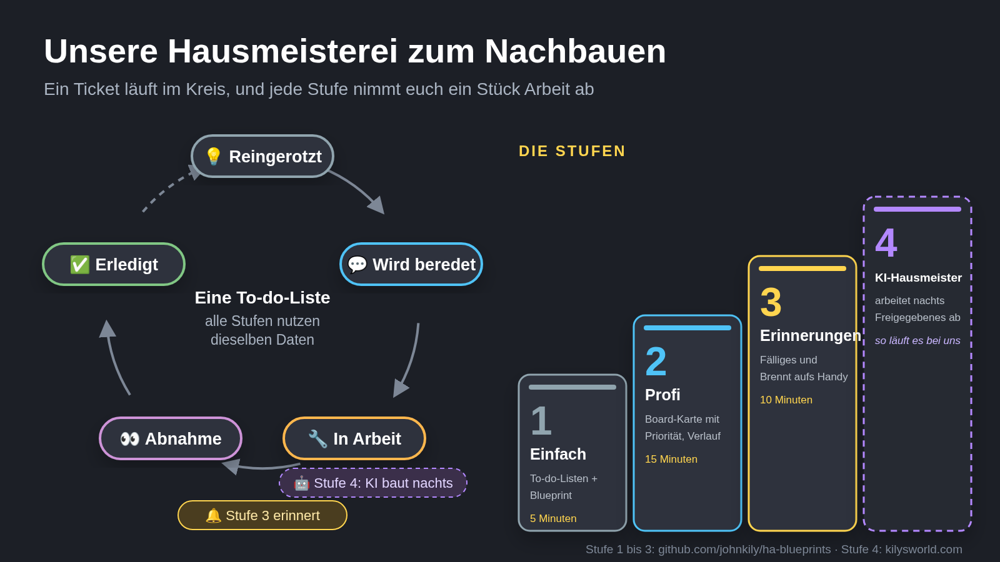
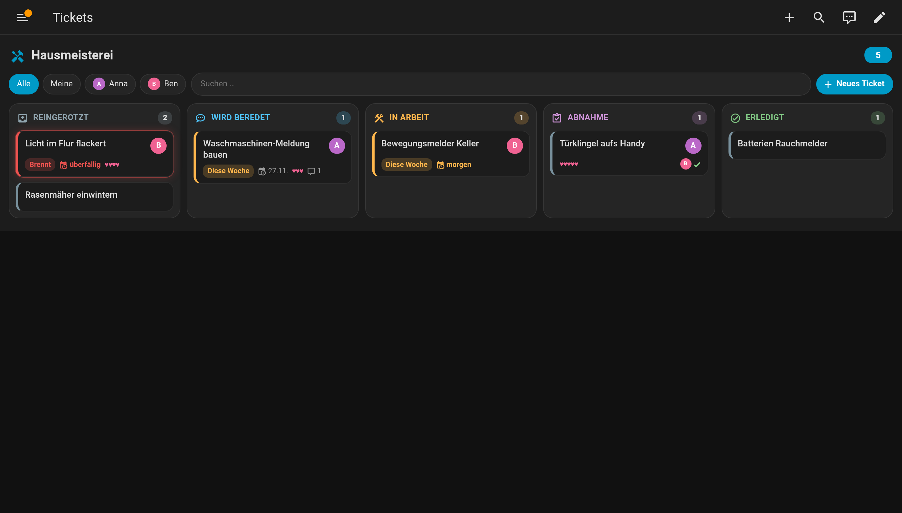

# Ticket-Board – alles, was im Haus zu tun ist

*[English version](en/ticket_board.md)*

Ein Kanban-Board für Home Assistant: Wünsche und Aufgaben landen als Ticket in Spalten, man sieht auf einen Blick, wer sich kümmert, was brennt und was fällig ist. Bei uns heißt das „Hausmeisterei“, und seitdem bleibt keine Idee mehr liegen.

Die Tickets liegen in einer ganz normalen **To-do-Liste von Home Assistant**. Keine Skripte, keine `configuration.yaml`, und alles steckt automatisch in jeder Sicherung. Die Liste siehst du sogar in der HA-App.

**Drei Stufen – steig ein, wo es passt:**



| Stufe | Was du bekommst | Was du brauchst | Zeit |
|---|---|---|---|
| **1 · [Einfach](#einfach-ohne-installation)** | Zwei oder drei Listen nebeneinander. Abhaken schiebt in die nächste Spalte, auf Wunsch mit Nachricht | Lokale To-do-Listen + ein Blueprint | 5 Minuten |
| **2 · [Profi](#profi-das-ticket-board)** | Ein richtiges Board mit Priorität, Zuständigen mit Foto, Fälligkeit, Filtern, Verlauf, Kommentaren und Abnahme | dazu eine Datei (die Karte) | 15 Minuten |
| **3 · [Profi + Erinnerungen](#erinnerungen-stufe-3)** | Das Haus erinnert von selbst: fällig, überfällig, Abnahme wartet, „Brennt“ bleibt liegen. Jeder bekommt seine eigenen Tickets aufs Handy | dazu ein Blueprint | 10 Minuten |

Alle Stufen arbeiten mit **To-do-Listen von Home Assistant**. Von Stufe 2 auf 3 geht nichts verloren, der Blueprint liest einfach mit. Nur beim Wechsel von 1 auf 2 legt man die offenen Tickets einmal neu an, die Profi-Karte übernimmt die Einträge der einfachen Variante nicht automatisch.

**Und darüber?** Bei uns arbeitet zusätzlich eine KI freigegebene Tickets nachts ab und legt sie zur Abnahme hin. Das ist (noch) kein Baustein zum Nachbauen, sondern unser eigenes, über Monate gewachsenes System. Wie es läuft, steht im Blog: [Unser Hausmeister ist eine KI](https://kilysworld.com/2026/11/22/unser-hausmeister-ist-eine-ki-wie-claude-nachts-unsere-smart-home-tickets-abarbeitet/).

## Einfach (ohne Installation)


**1. Listen anlegen:** *Einstellungen → Geräte & Dienste → Integration hinzufügen* → **Lokale To-do-Liste**, das Ganze zwei- oder dreimal, z. B. „Ideen“, „In Arbeit“ und „Abnahme“.

**2. Blueprint importieren:**

[](https://my.home-assistant.io/redirect/blueprint_import/?blueprint_url=https%3A%2F%2Fgithub.com%2Fjohnkily%2Fha-blueprints%2Fblob%2Fmain%2Fblueprints%2Fautomation%2Ftickets%2Fticket_board_einfach.yaml)

*Einstellungen → Automationen & Szenen → Blueprints* → **Ticket-Board einfach – Abhaken schiebt weiter**: die Listen in der Reihenfolge eintragen. Unter „Nachricht, wenn etwas in der letzten Spalte landet“ auf Wunsch die Handys, dann weiß der Wünschende, dass er nachschauen kann.

**3. Karten einfügen:** für jede Liste eine **To-do-Liste**-Karte (*Karte hinzufügen → To-do-Liste*), am besten nebeneinander in einer Abschnitts-Ansicht.

**So arbeitet man damit:** Neues kommt in „Ideen“ (auch per Sprachassistent: „Füge Glühbirne Bad zu Ideen hinzu“). Abhaken schiebt in „In Arbeit“, dort abhaken schiebt in „Abnahme“. Abgehakt in der letzten Liste ist erledigt – der Eintrag bleibt unter „Erledigt“ stehen, bis man ihn löscht. Beschreibung und Fälligkeit wandern mit. Was brennt, bekommt ein 🔥 vor den Titel.

## Profi: das Ticket-Board



### Was es kann

- **Fünf Spalten:** Reingerotzt, Wird beredet, In Arbeit, Abnahme, Erledigt. Am PC einfach Karten zwischen den Spalten ziehen, am Handy tippen und den Status wählen.
- **Wie eilig:** Irgendwann, Diese Woche, Brennt. Brennende Tickets leuchten rot.
- **Wer kümmert sich:** mit Foto aus der Person in Home Assistant. Filter für Alle, Meine oder je Person.
- **Fällig:** mit Schnellwahl „in 1 Woche“, „in 2 Wochen“, „in 1 Monat“. Überfällige Tickets sind rot markiert.
- **Wie wichtig:** bis zu fünf Herzchen.
- **Verlauf und Kommentare:** jede Statusänderung mit Name und Uhrzeit, dazu Kommentare wie in einem Chat.
- **Abnahme:** In der Spalte Abnahme zeigt die Karte, wer sich das Ticket gewünscht hat. Der schaut dann, ob es passt.
- **Archiv:** Erledigt zeigt die neuesten sechs, der Rest ist einen Tipp entfernt. Gelöscht wird nichts.
- **Deutsch und Englisch,** passend zur Sprache in Home Assistant. Hell und dunkel, passend zum Theme.


### 1. To-do-Liste anlegen

*Einstellungen → Geräte & Dienste → Integration hinzufügen* → **Lokale To-do-Liste** → Name z. B. „Hausmeisterei“. Danach gibt es die Entität `todo.hausmeisterei`.

### 2. Karte installieren

**Über den Marketplace (früher HACS), empfohlen** – dann kommen Updates per Klick:

[](https://my.home-assistant.io/redirect/hacs_repository/?owner=johnkily&repository=ticket-board-card&category=plugin)

Der Knopf öffnet die Karte im Marketplace → **Herunterladen**, danach Browser bzw. App neu laden. Ohne Knopf: *Einstellungen → Marketplace → ⋮ → Benutzerdefinierte Repositories* → `https://github.com/johnkily/ticket-board-card`, Typ **Dashboard**.

**Oder von Hand:**

1. Die Datei [`ticket-board-card.js`](https://github.com/johnkily/ticket-board-card/blob/main/ticket-board-card.js) herunterladen (rechts oben „Download raw file“).
2. In Home Assistant nach `/config/www/` kopieren, z. B. mit der App *File editor* oder *Samba*. Gibt es den Ordner `www` noch nicht, anlegen.
3. *Einstellungen → Dashboards → ⋮ → Ressourcen → Ressource hinzufügen*: URL `/local/ticket-board-card.js?v=1`, Typ **JavaScript-Modul**.
4. Browser bzw. App einmal neu laden.

Bei einer neuen Version die Datei ersetzen und in der Ressource die Zahl hinter `?v=` hochzählen, sonst zeigt der Browser noch die alte.

### 3. Karte einfügen

Dashboard bearbeiten → *Karte hinzufügen* → ganz unten **Manuell** → einfügen:

```yaml
type: custom:ticket-board-card
entity: todo.hausmeisterei
titel: Hausmeisterei
personen:
  - person.anna
  - person.ben
```

- `entity` – deine To-do-Liste (Pflicht)
- `titel` – Überschrift über dem Board
- `personen` – wer Tickets übernehmen kann. Ohne diese Zeilen gibt es keine Zuständigen und keine Personen-Filter.
- `archiv` – wie viele erledigte Tickets sichtbar sind (Vorgabe 6)

Am besten passt die Karte in eine Ansicht vom Typ **Panel** oder in einen Abschnitt über die volle Breite.

## Erinnerungen (Stufe 3)

Ein Board hilft nur, wenn jemand draufschaut. Der Blueprint **Ticket-Board – Erinnerungen** schaut einmal am Tag für dich nach und schickt eine Nachricht, wenn etwas liegen bleibt:

| Zeichen | Wann | Vorgabe |
|---|---|---|
| 🔥 | „Brennt“, in den ersten beiden Spalten und seit … Tagen nicht angefasst | 1 Tag |
| 📅 | Fällig heute oder überfällig (nicht in Abnahme oder Erledigt) | an |
| 👀 | Wartet seit … Tagen auf Abnahme | 2 Tage |
| 💤 | Liegt seit … Tagen in der ersten Spalte | aus |

Neue „Brennt“-Tickets meldet er **sofort**, nicht erst am nächsten Morgen.

**Wer bekommt was?** Die Handys unter „Handys“ bekommen die ganze Liste. Ist „Zuständige bekommen ihre eigenen Tickets“ an, geht zusätzlich an jeden Zuständigen eine Nachricht nur mit seinen Tickets, über das Handy, das in Home Assistant zu seiner Person gehört (Companion-App). Wer schon unter „Handys“ steht, bekommt nichts doppelt. Für Telegram, Signal oder E-Mail trägst du ein eigenes Skript ein, es bekommt `titel` und `nachricht` (Vorlagen in der [Anleitung zum Zigbee-Wächter](zigbee_waechter.md)).

**Einrichten:**

[](https://my.home-assistant.io/redirect/blueprint_import/?blueprint_url=https%3A%2F%2Fgithub.com%2Fjohnkily%2Fha-blueprints%2Fblob%2Fmain%2Fblueprints%2Fautomation%2Ftickets%2Fticket_board_erinnerungen.yaml)

*Einstellungen → Automationen & Szenen → Blueprints* → **Ticket-Board – Erinnerungen**: unter „Board“ dieselbe To-do-Liste wie in der Karte, Uhrzeit wählen, Empfänger eintragen. Mit „Dashboard-Pfad zum Board“ (z. B. `/lovelace/tickets`) öffnet ein Tipp auf die Nachricht gleich das Board.

So sieht die Morgenmeldung aus:

```
📋 Ticket-Board (4)
🔥 Licht im Flur flackert – brennt, seit 2 Tg. unberührt
📅 Waschmaschinen-Meldung – seit 1 Tg. überfällig · Ben
📅 Rollo Wohnzimmer hakt – heute fällig
👀 Türklingel aufs Handy – wartet seit 3 Tg. auf Abnahme · Anna
```

Ist nichts fällig, kommt auch nichts. Der Blueprint gehört zur Profi-Karte: Einträge ohne die ⚙-Zeile (z. B. aus der einfachen Variante) überspringt er.

## Gut zu wissen

- **Wer etwas anlegt, wird als „gewünscht von“ gespeichert.** Dafür muss der HA-Benutzer mit seiner Person verknüpft sein (*Einstellungen → Personen*). Sonst steht dort der Benutzername.
- **Die Zusatzangaben** (Status, Priorität, Verlauf …) stehen am Ende der Beschreibung des To-do-Eintrags hinter einem ⚙. Wer die Liste in der HA-App öffnet, sieht sie dort. Diese Zeile bitte nicht von Hand ändern.
- **Erledigt** setzt in der To-do-Liste auch das Häkchen. Hakt jemand einen Eintrag in der App ab, landet er im Board unter Erledigt.
- **Fotos und Dateien** kann die Karte nicht. Dafür gibt es in unserem eigenen System einen Ordner je Ticket auf dem NAS, das ist aber deutlich aufwendiger.

## Klappt nicht?

| Problem | Lösung |
|---|---|
| „Custom element doesn't exist“ | Karte im Marketplace heruntergeladen bzw. Ressource eingetragen (Schritt 2)? Danach Browser bzw. App neu laden. |
| Board bleibt leer mit Fehlermeldung | Stimmt der Name der To-do-Liste unter `entity`? |
| „Meine“ zeigt nichts | Ist dein HA-Benutzer mit deiner Person verknüpft? |
| Alte Version wird angezeigt | Von Hand installiert: Zahl hinter `?v=` in der Ressource hochzählen. Marketplace: App bzw. Browser neu laden. |

---

**Gefällt es dir?** Ein ⭐ auf [GitHub](https://github.com/johnkily/ha-blueprints) hilft anderen, es zu finden – Fragen und Wünsche gern als [Issue](https://github.com/johnkily/ha-blueprints/issues) oder unter [Ideen](https://github.com/johnkily/ha-blueprints/discussions/categories/ideas).
